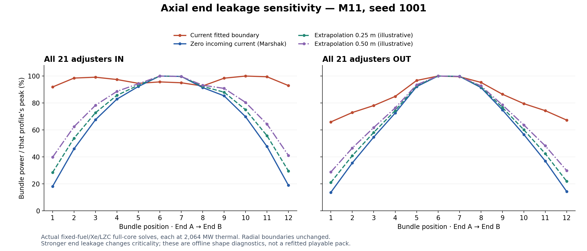

# Axial boundary sensitivity

The [calibration history](../../docs/physics/calibration-provenance.md) places
this sensitivity experiment in the development of the current axial boundary.



Eight full-core solves use the same seed-1001 aged inventory, frozen xenon and
LZC levels, radial boundaries and 2,064 MW thermal normalization. Axial leakage
alone is varied, with all adjusters in and out. Every solve converged below
2e-7 residual. The data includes an M11 channel comparison.
The stronger-boundary cases are sensitivity experiments and have not been
refitted or staged as a runtime pack.

- [Raw solve data](axial-boundary-audit.json)
- [Bundle values](axial-boundary-bundles.csv)
- [Vector figure](axial-boundary-comparison.svg)
- [Plot source](plot_axial_boundary.py)

Run the audit with a separate output path. Matching the recorded results requires the pack and source used for this measurement. The plot script reads the checked-in data and rewrites its figures.

```powershell
dotnet run --project tools/AgedCoreBenchmark -c Release -- --axial-boundary-audit tmp/axial-boundary-audit.json
```
