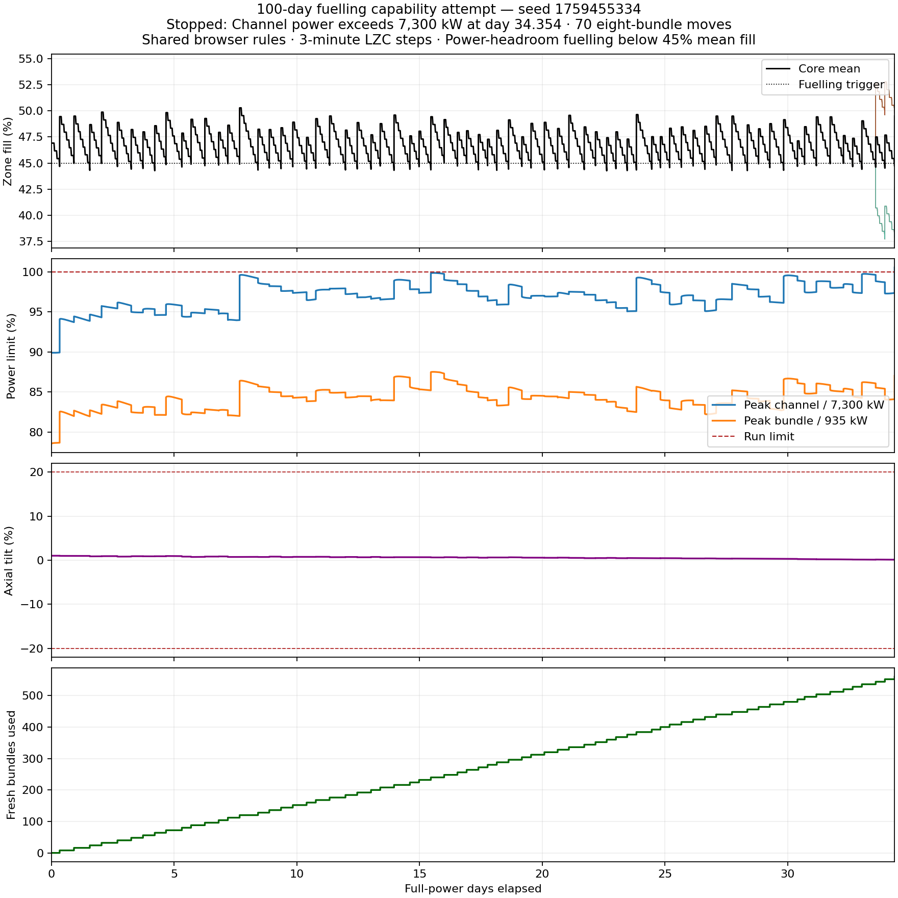
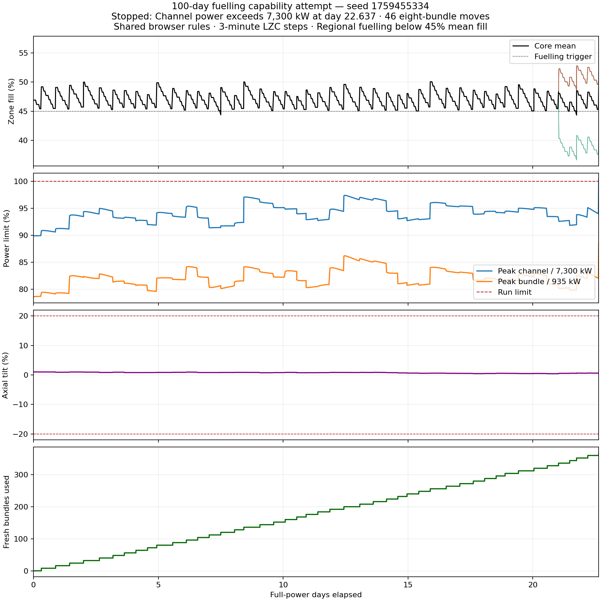

# 100-day fuelling capability attempts — 2026-10-06

With the recorded v3 configuration, neither tested policy reached 100 full-power days. Both attempts ended on its 7,300 kW channel-power limit after an accepted fuel move. These results apply to the recorded pack and limits, not the current game.

Both runs used seed **1759455334**, initially drawn from cryptographic randomness,
and the authoritative endless browser-factory `GameSession` at 100% full power:
2,064 MW thermal / 650 MW electrical. The active pack was
`candu6-two-group-diffusion-v1-cycle190-650mwe-reactivity-v3`.
Xenon, three-minute spatial/LZC solves, unlimited fuel and all normal terminal
limits remained active. There were no physics, inventory or horizon overrides.
The shared simulation source was committed in `6930967`.

| Policy | Ending day | Eight-bundle moves | Fresh bundles | Highest observed channel kW | Highest observed bundle kW | Ending mean LZC | Ending axial tilt |
| --- | ---: | ---: | ---: | ---: | ---: | ---: | ---: |
| Oldest eligible fuel in the lowest-fill region when regional fills differ | 22.6375 | 46 | 368 | 7,333.035 | 829.079 | 49.269% | +0.603% |
| Existing power-deficit / fresh-fuel-headroom policy | 34.3542 | 70 | 560 | 7,340.909 | 818.316 | 49.500% | +0.137% |

The longer run ended when **L14** reached 7,340.909 kW after refuelling **J14**.
J14 itself reached 6,991.218 kW: the limit violation occurred elsewhere in the
coupled core. The longer run delivered 1,701,768 MWh thermal and an estimated
535,925 MWh electrical. Its final score was 597.044 points; fuel use averaged
about 16.3 fresh bundles/day. These two policies on this seed are the tested
scope; the results do not establish the outcome of other policies or seeds.

The regional tool checked power and fuel accounting after every three-minute
advance and fuel move, and saved hourly observations plus all fuel moves.
The power-headroom tool requested 10× playback; Game integrated, solved LZC and
checked ending conditions at every internal three-minute boundary. Its saved
observations are half-hour snapshots plus instantaneous fuel moves, so reported
extrema are observed snapshot extrema. Its time-weighted ripple estimates use
half-hour left-held samples; score and energy totals use the three-minute cadence.

Calculation cost increased as individual zone fills became nonuniform. The
regional run took 994.85 s; the power-headroom run took 653.71 s on the local
native Release runtime. The longer run averaged roughly 14.6 wall seconds/day
through day 33; day 34 took roughly 95 seconds. Live diagnostics placed the extra
work in spatial equilibrium candidate solving. These native measurements do not
measure the deployed AOT WASM runtime.

An oldest-channel-only baseline stopped at its day-23 checkpoint is not included
as a completed or terminal 100-day attempt. Its local report is not tracked in
this repository.

## Saved evidence

- [Regional report](regional-report.json) and [plot](regional.png).
- [Power-headroom report](reserve-report.json), [snapshot trace](reserve-report.jsonl)
  and [plot](reserve.png).





## Reproduce

The benchmark commands require the recorded v3 source and pack identified above. Running them against the current checkout measures its current model and does not reproduce these figures.

```powershell
dotnet run --project tools/AgedCoreBenchmark -c Release -- --fuelling-100-days artifacts/fuelling-100-days-balanced 1759455334
dotnet run --project tools/LongRunPlaytest -c Release -- --endless=true --days=100 --seed=1759455334 --threshold=.45 --policy=reserve --output=artifacts/fuelling-100-days-reserve
```

To render the checked-in reports, independently of the commands above, use
Python with Matplotlib and run the following. Both plots overwrite
`fuelling-capability.png` beside their inputs; preserve any existing file first.
The commands move each generated plot
to `tmp`; choose unused destination names if those files already exist. The
reserve plot requires `reserve-report.jsonl` beside `reserve-report.json`.

```powershell
New-Item -ItemType Directory -Force -Path tmp | Out-Null
python tools/AgedCoreBenchmark/plot-fuelling-capability.py benchmarks/fuelling-capability-2026-10-06/regional-report.json
Move-Item -LiteralPath benchmarks/fuelling-capability-2026-10-06/fuelling-capability.png -Destination tmp/regional-v3.png
python tools/AgedCoreBenchmark/plot-fuelling-capability.py benchmarks/fuelling-capability-2026-10-06/reserve-report.json
Move-Item -LiteralPath benchmarks/fuelling-capability-2026-10-06/fuelling-capability.png -Destination tmp/reserve-v3.png
```
