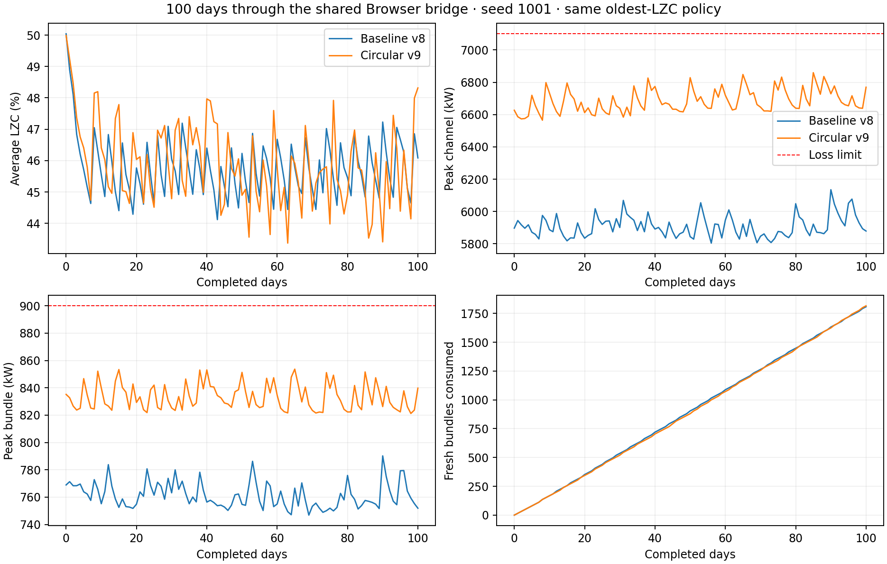

# Circular radial boundary verification

The [physics notes](../../docs/physics/radial-circle-v9.md) describe the geometry,
preserved axial boundary, calibration, and reference change.

Both campaigns use seed 1001, normal 2,064 MW thermal / 650 MW electrical
browser defaults, unlimited fuel, atomic one-day integration, and the same
`oldest-lzc` player policy: two oldest channels/day, adding a third when the
previous day's published average LZC is below 45%. No physics, score, power,
inventory or loss-limit overrides are used. Assemblies were copied to isolated
directories before each run so later builds could not replace loaded binaries.

These are native .NET campaigns through the versioned Browser bridge and shared
Core/Game simulation. Browser-WASM release checks are separate. Campaign wall
times are not a controlled performance comparison.

| Measurement | Baseline v8 | Circular v9 |
| --- | ---: | ---: |
| Completed days | 100 | 100 |
| Fuel bundles | 1,808 | 1,816 |
| Mean discharge burnup, MWd/kg | 6.153724 | 6.159628 |
| Score | 2,302.809 | 2,304.433 |
| Thermal energy, MWh | 4,953,600 | 4,953,600 |
| Electrical energy, MWh | 1,560,000 | 1,560,000 |
| Average LZC range, % | 44.119–50.041 | 43.371–49.985 |
| Final average LZC, % | 46.086 | 48.317 |
| Maximum absolute axial tilt, % | 0.553 | 0.545 |
| Highest observed channel power, kW | 6,135.083 | 6,859.532 |
| Highest observed bundle power, kW | 790.224 | 853.666 |

Final Keff stays within 0.999987586–1.000032667. The intended radial redistribution
raises peak powers, while fuel demand, discharge burnup, score, energy, control
range and axial tilt stay close to the baseline. These results establish this
seed/policy's 100-day survival, not all possible player actions.



Evidence:

- [Fresh baseline campaign](baseline.json), [final campaign](campaign.json),
  [final commands and digests](campaign-commands.jsonl).
- [Machine-readable comparison](comparison.json).
- [Archived v8 fixed reference](baseline-reference.json),
  [all 380 final references](reference/reference.json), [CSV](reference/reference.csv),
  [power-map figure](reference-comparison.png).
- [Independent calibration](../../data/calibration/radial-circle-v9/fit/fit.json)
  and [iterations](../../data/calibration/radial-circle-v9/fit/trials.json).
- [Verification record](verification.json), [Pages daily smoke](browser-acceptance.json),
  [cold/warm WASM reproduction](reproduction.json), [browser core screenshot](browser-core.png).

Final checks passed 124 Core, 86 Game, 46 Browser and 214 frontend tests, plus
the production and `/CRS/` subpath builds. The local Release, single-threaded,
non-AOT WASM smoke passed daily fuel/empty turns, frozen planning, narrow layout,
terminal feedback and unavailable-WASM recovery. All twelve reproduction rows
were accepted; cold/warm digests matched and no browser errors were reported.
This verifies the uncommitted working tree at the recorded base commit and pack
hash; it is not a published deployment or an AOT performance measurement.

Reproduce a final campaign with a new output prefix:

```powershell
dotnet run --project tools/LongRunPlaytest -c Release -- --pacing=daily-turn --policy=oldest-lzc --channels-per-day=2 --days=100 --seed=1001 --output=tmp/radial-v9-seed1001
```
