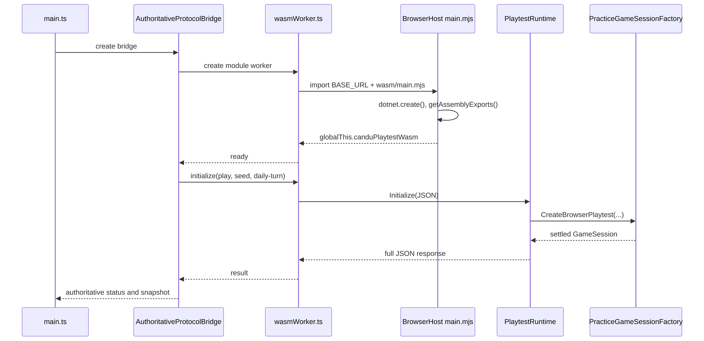

---
hide:
  - toc
---

# 1. Entry points and startup

[Library](index.md) · [Next: commands and transport](02-browser-transport.md)

An **entry point** is the first operation invoked when a program or execution
context starts. CRS has a browser interface and a separate worker context that
loads the C# runtime. Its startup therefore crosses several entry points before
a reactor observation is available.

The **main thread** processes interface events and rendering. A **Web Worker**
is a separate JavaScript execution context reached through messages; placing
simulation work there allows the interface to remain responsive. The .NET host
runs inside that worker using WebAssembly, a browser-supported executable format.
The term **managed code** refers here to C# code executed under the .NET runtime,
which provides services such as memory management.

## Read the startup code beside its explanation

Read each row from left to right, then continue downward. The left column is an
unmodified excerpt of a repository file, with its original line numbers. The right
column explains those exact lines. On a narrow screen, the explanation appears
immediately below its code. Select a line number to open that line in the full file.

### The HTML hands execution to TypeScript

These are the final elements of the page. They establish the targets that the
entry script looks up; no reactor state exists in these elements.

```annotated-source
path: web/candu-playtest/index.html
title: Mounting points and the module entry
language: html
start: <body>
end: '<script type="module" src="/src/main.ts"></script>

  </body>

  </html>'
steps:
- through: <div id="game-root"></div>
  explanation: '**Create the mounting point.** The browser parses the body and creates an empty element with ID `game-root`. `AppShell` will attach the launcher or active game view here.'
- through: <div id="status-mirror" aria-hidden="true"></div>
  explanation: '**Expose a diagnostic target.** Smoke checks read this element and its data attributes. `aria-hidden="true"` prevents these frequent diagnostic updates from becoming screen-reader announcements.'
- through: <div id="session-announcements" role="status" aria-live="polite" aria-atomic="true"></div>
  explanation: '**Create the accessible announcement region.** `polite` asks assistive technology to announce updates when convenient; `atomic` requests the whole message. This is separate from the hidden diagnostic target.'
- through: '<script type="module" src="/src/main.ts"></script>

    </body>

    </html>'
  explanation: '**Load the program entry.** A module script enables imports. Vite transforms `/src/main.ts` into the deployed JavaScript bundle. The closing tags finish the page; application construction proceeds in that module.'
```

### main.ts constructs and connects the application

The complete entry file follows. Its job is to give all views the same controller
and to attach lifecycle listeners. A **subscription** is a callback registered to
receive later updates; it is not a one-time read of the current reactor.

```annotated-source
path: web/candu-playtest/src/main.ts
title: The complete browser composition root
language: typescript
start: import { AppShell } from "./AppShell";
end: '});

  window.addEventListener("beforeunload", () => { updates.destroy(); player.destroy(); shell.destroy(); session.dispose(); }, { once: true });'
steps:
- through: import { createCanduPlaytestBridge } from "./bridge";
  explanation: '**Import the building blocks.** `AppShell` owns the active view; the controller owns browser session coordination. Recovery, announcements, player controls and update handling are separate components. Imports identify dependencies; they do not create a reactor.'
- through: '}), {}, "daily-turn");'
  explanation: '**Construct one shared session.** The inner call creates the authoritative bridge with daily pacing. The controller wraps that bridge; `{}` supplies default controller options. The final `"daily-turn"` makes daily pacing a client requirement as well. Keeping one controller means switching views preserves the same run and draft.'
- through: 'const announcements = liveRegion ? new SessionAnnouncements(liveRegion) : null;'
  explanation: '**Locate the feedback targets.** `document.getElementById` can return `null`. The conditional expression constructs announcements only if the live-region element exists. Recovery is mounted on `document.body` so loading failures can be shown before a game view is ready.'
- through: announcements?.update(update);
  explanation: '**Subscribe to session changes.** Each callback updates recovery status and, when present, announcements. The `?.` operator skips the method call if `announcements` is `null`. The rest of the callback maintains diagnostics.'
- through: statusMirror.dataset.fuelConsumed = String(snapshot.shift?.fuelConsumed ?? 0);
  explanation: '**Publish machine-readable observations.** The guard checks that the diagnostic element exists. `snapshot` is the observation supplied by the controller. `dataset` writes `data-*` attributes; `String` converts numeric readings to attribute text. `??` supplies a fallback only for `null` or `undefined`. These assignments display state; they do not advance it.'
- through: ': `${update.status.title}. ${update.status.detail}`;

    }

    });'
  explanation: '**Choose the diagnostic message.** The ternary expression displays reactor measurements when WASM is available, otherwise the loading/error title and detail. Template strings insert readings; `toFixed(1)` formats score for display. The nested conditionals choose paused/running, unlimited/finite fuel and a response message. The braces close the guard and subscription callback.'
- through: const updates = new GameUpdateView(session, () => player.saveBeforeUpdate());
  explanation: '**Connect the views to that session.** The non-null assertion `!` tells TypeScript that `game-root` must exist. `() => shell.showStudio()` is a callback for navigation; `() => player.saveBeforeUpdate()` is a callback invoked later during updating. Neither callback runs merely because it is passed to a constructor.'
- through: void updates.initialize(import.meta.env.BASE_URL, import.meta.env.PROD);
  explanation: '**Start update discovery.** Vite supplies the deployment base path and production flag. `initialize` is asynchronous; `void` explicitly discards its returned promise at this call site. Initialization of the UI can continue while update discovery runs.'
- through: '});

    window.addEventListener("beforeunload", () => { updates.destroy(); player.destroy(); shell.destroy(); session.dispose(); }, { once: true });'
  explanation: '**Follow browser lifecycle events.** Visibility changes inform the scheduler when the tab is hidden or visible. Before unloading, cleanup destroys view resources and disposes the session/worker. `{ once: true }` makes that unload listener run at most once. Daily turns still advance only through a committed command.'
```

## There are three entry points

| Entry | Runs in | Purpose |
| --- | --- | --- |
| [index.html](../../web/candu-playtest/index.html) → [main.ts](../../web/candu-playtest/src/main.ts) | Browser main thread | Compose the application, session and UI |
| [wasmWorker.ts](../../web/candu-playtest/src/wasmWorker.ts) | Dedicated browser worker | Load WASM and execute queued requests |
| [main.mjs](../../src/ReactorSim.BrowserHost/main.mjs) → [BrowserExports.cs](../../src/ReactorSim.BrowserHost/BrowserExports.cs) | .NET runtime inside that worker | Expose managed JSON operations to JavaScript |

[Program.Main()](../../src/ReactorSim.BrowserHost/Program.cs) is deliberately empty.
The executable host needs a managed startup target, but gameplay enters through
the JavaScript exports. Starting a debugger at `Main()` alone will miss the
actual initialization and command path.

## Step 1: HTML creates the mounting and accessibility targets

`index.html` supplies `#game-root`, the hidden `#status-mirror`, and the polite
`#session-announcements` live region. Its module script loads `/src/main.ts`;
Vite resolves that source entry into the production build.

The game root receives the current native DOM/SVG view. The status mirror is
`aria-hidden` and exposes diagnostic text/data attributes to smoke tools. The
separate live region announces session changes to assistive technology.

## Step 2: main.ts composes long-lived objects

The statements in `main.ts` establish the following objects and lifecycle events
in source order:

1. `createCanduPlaytestBridge({ initialPacingMode: "daily-turn" })` starts the
   authoritative bridge lifecycle.
2. `new BridgeSessionController(bridge, {}, "daily-turn")` wraps it. The final
   argument requires daily pacing for this public client.
3. A session subscription updates bridge recovery, announcements and the smoke
   mirror whenever status or observations change.
4. `AppShell` mounts the launcher. `PlayerPanel` adds player/save controls, and
   `GameUpdateView` manages build/update discovery.
5. Update initialization receives Vite's base URL and production flag.
6. Visibility changes inform the controller. `beforeunload` destroys the update
   view, player panel and shell, then disposes the controller.

This file wires components together; it does not solve physics or own game rules.
Objects are created before WASM is ready so loading and recovery can be shown.

## Step 3: the bridge creates a worker and a loading observation

In [bridge.ts](../../web/candu-playtest/src/bridge.ts),
`createCanduPlaytestBridge()` returns `AuthoritativeProtocolBridge`.
Its initial active bridge is `UnavailableProtocolBridge`, paired with a
shape-compatible placeholder and loading status. That placeholder lets views
render their structure; its commands reject and its physics is not authoritative.

The lifecycle bridge creates `WorkerProtocolBridge`, which creates a module
worker using `new URL("./wasmWorker.ts", import.meta.url)`. It registers message
handlers and a startup deadline. Once the worker reports ready, the lifecycle
bridge requests initialization with a random core seed and daily pacing.

**Figure 2. Startup sequence.** This sequence diagram shows how the interface
obtains its first authoritative observation. Time proceeds downward. Each named
column represents a participant; solid arrows denote calls or requests, dashed
arrows denote returned information, and the host's self-arrow denotes work within
that participant. Asynchronous startup means that the interface can display a
loading state while these operations finish.



The first part constructs the bridge and loads the host. The worker's `ready`
message confirms that exports are available; it does not yet mean a reactor has
been created. The subsequent `Initialize(JSON)` request constructs and settles
the session, after which the full response travels back to the interface.
The diagram abbreviates the thin `BrowserExports`/`PlaytestBridgeV2` forwarding
calls between the worker and `PlaytestRuntime`.

In the Mermaid source, `participant` declares a column and `as` assigns its
display label. The opening `init` directive disables automatic width reduction
for this figure, allowing horizontal scrolling while keeping labels readable.
These statements control the documentation figure, not application startup.

## Step 4: the worker loads the .NET host

`loadWasm()` builds its module URL from `import.meta.env.BASE_URL`, so the Pages
subpath `/CRS/` is part of asset resolution. It imports `wasm/main.mjs`, locates
the exported facade through `findWasmExports()`, and reports either `ready` or
`load-error`.

The host's `main.mjs` imports `_framework/dotnet.js`, creates the runtime, reads
its main assembly name and fetches assembly exports. It then assigns a small
`globalThis.canduPlaytestWasm` object. Each function forwards a JSON string to a
`[JSExport]` method in `BrowserExports`. Finally it runs managed `Main()`.

The exports delegate to
[PlaytestBridgeV2](../../src/ReactorSim.Browser/PlaytestBridge.cs), a static facade
over one default `PlaytestRuntime`. Tests and tools can instantiate independent
runtimes; the facade does not make all runtimes share a session.

### The worker resolves the deployed host

The worker uses the same deployment base as the main application. This is why a
GitHub Pages subpath must be included when loading the host.

```annotated-source
path: web/candu-playtest/src/wasmWorker.ts
title: Load WebAssembly exports or report a startup failure
language: typescript
start: 'async function loadWasm(): Promise<CanduPlaytestWasmExports> {'
end: 'throw error;

  }

  }'
steps:
- through: await import(/* @vite-ignore */ moduleUrl);
  explanation: '**Resolve and import the host.** `new URL` combines the Vite base path with the worker location and returns an absolute URL. `@vite-ignore` leaves this runtime URL for the browser to import. Awaiting the module also waits for its top-level runtime setup.'
- through: 'throw new Error("The browser WASM module loaded without canduPlaytestWasm exports.");

    }'
  explanation: '**Check the actual API.** Loading a file successfully does not prove it exposed the required functions. `findWasmExports` validates the facade; a missing facade becomes an explicit startup failure.'
- through: return wasmExports;
  explanation: '**Signal transport readiness.** The `ready` message means exported functions are available. Returning them resolves the promise used by queued requests. A reactor is created later by the initialization request.'
- through: 'throw error;

    }

    }'
  explanation: '**Report and propagate failure.** The main thread receives a readable `load-error`. Rethrowing also rejects the export promise so queued requests cannot accidentally proceed with an unavailable runtime.'
```

### The JavaScript host exposes C# operations

The worker's imported module is a small adapter. Its functions accept and return
JSON through managed exports; the reactor algorithms remain in C#.

```annotated-source
path: src/ReactorSim.BrowserHost/main.mjs
title: The complete .NET host adapter
language: javascript
start: import { dotnet } from "./_framework/dotnet.js";
end: await runtime.runMain();
steps:
- through: const exports = assemblyExports.ReactorSim.BrowserHost.BrowserExports;
  explanation: '**Load .NET and locate the managed class.** `dotnet.create()` starts the browser runtime. Configuration supplies the main assembly name; `getAssemblyExports` retrieves its JavaScript-callable exports. `BrowserExports` is the C# boundary class.'
- through: 'dispatchJson: (commandJson) => exports.DispatchJson(commandJson),'
  explanation: '**Publish the worker-facing facade.** Assigning `globalThis.canduPlaytestWasm` makes these wrappers discoverable by `findWasmExports`. Each arrow function forwards an input to the corresponding C# export. `begin` and `continue` separate daily work so JavaScript can yield between calls; ordinary dispatch is also available.'
- through: '...(typeof exports.DispatchProfileJson === "function" ? { dispatchProfileJson: commandJson => exports.DispatchProfileJson(commandJson) } : {}),

    };'
  explanation: '**Include profiling only when supported.** Object spread adds the optional function when this build exposes it. Otherwise the facade omits it; callers must check capability before profiling.'
- through: await runtime.runMain();
  explanation: '**Finish managed startup.** The executable host still has a managed entry point. Its empty `Main()` satisfies the executable lifecycle; gameplay enters through the exports above.'
```

## Step 5: the Browser layer validates initialization

[PlaytestRuntime.Initialize()](../../src/ReactorSim.Browser/PlaytestRuntime.cs)
parses the JSON request and checks protocol, mode, seed, objective and pacing.
The supported game mode is `play`. The seed is a 32-bit unsigned value at the
browser boundary. Invalid requests produce diagnostics rather than silently
selecting another mode.

The runtime constructs a candidate session before replacing its current runtime.
Its session is lazy: merely obtaining capabilities does not construct a full core.
This keeps a solver initialization error from being hidden inside a managed
type-initializer failure.

## Step 6: the Game factory creates the initial reactor

[PracticeGameSessionFactory.CreateBrowserPlaytest()](../../src/ReactorSim.Game/PracticeGameSessionFactory.cs)
delegates to `CreateBrowserSession()` and `CreateSession()`. A **factory** is a
function or class responsible for constructing an object with its required
dependencies. This factory establishes a consistent initial session in the
following order:

1. Build the time model, retained playback modes and `PracticeRunClock`.
   Free practice is endless with unlimited stock; the challenge has a finite
   horizon and stock.
2. Load `FullCoreDiffusionDataPackV1` from the embedded authored pack and create
   `FullCoreDiffusionModelV1` for the CANDU topology.
3. Create the seeded aged bundle inventory using
   `SyntheticGameCoreStateV1.CreateAgedPractice(seed)`.
4. Create `EquilibriumCoreSolverV1` at the 2,064 MW thermal reference output.
5. Create the fourteen-zone reactor regulating-system (RRS) mapping and initial
   RRS state. This controller calculates the liquid-zone response used to regulate
   the model's neutron balance and power distribution.
6. Run RRS equilibrium and commit the projection. A bounded additional settling
   loop reduces initial net reactivity without advancing run time or using fuel.
7. If the pack supplies a xenon reference, iterate assumed pre-run poison
   equilibrium and RRS together. Failure to settle raises an actionable error;
   the factory does not return a partly settled reactor.
8. Construct `GameSession` with inventory, solver, RRS, clock and poison.
9. For daily browser play, `UseDailyTurns()` selects daily pacing and pauses the
   clock. Challenge setup also pauses before play.

The **seed** is an integer used to make the initial aged inventory reproducible.
The authored pack and algorithms determine
the subsequent numerical result. Retrying with the same seed and objective
recreates the same initial conditions; drawing a seed is browser input generation,
not simulation randomness added during a day.

### Bind the initial inventory to the physics model

This excerpt is the central construction section of `CreateSession`. The
preceding code builds the clock and playback modes; the following code settles
RRS and xenon before returning a session. `Require` unwraps a valid contract result
or throws its diagnostic, so each dependency must be constructed successfully.

```annotated-source
path: src/ReactorSim.Game/PracticeGameSessionFactory.cs
title: Create the model, aged fuel and equilibrium solver
language: csharp
start: FullCoreDiffusionDataPackV1 dataPack = Require(
end: runtime.SimulationTimeSeconds));
steps:
- through: FullCoreDiffusionModelV1.TryCreateCandu6(dataPack));
  explanation: '**Load the authored model.** The embedded pack supplies material data and numerical policy. `TryCreateCandu6` binds it to the CANDU topology. The pack is a local runtime input, so no external analysis application is required.'
- through: if (unlimitedFreshFuel) coreState = coreState.WithUnlimitedFreshFuel();
  explanation: '**Create reproducible initial fuel.** The seed determines the aged inventory. Unlimited practice changes stock policy while preserving consumption accounting; it does not change the inventory into a browser-owned model.'
- through: PracticeReferencePowerWatts));
  explanation: '**Solve the initial spatial state.** The solver receives the model, every bundle and reference power in watts. Its accepted projection will provide the power shape read by the session and presentation layer.'
- through: runtime.SimulationTimeSeconds));
  explanation: '**Construct regulation state.** The mapping identifies fourteen liquid zones. Initial RRS state is derived from the accepted projection and current simulation time. Later settling passes reconcile this control state with the equilibrium solution before the player sees the core.'
```

## Step 7: readiness unlocks the launcher

The lifecycle bridge parses the first snapshot and checks daily pacing and
`practice-daily-one-step-v1` cadence identity. Only then does it switch to the
worker as the active bridge and publish authoritative status. Errors make the
bridge unavailable; they never activate a TypeScript simulation.

[AppShell](../../web/candu-playtest/src/AppShell.ts) initially owns a
`LauncherView`. `showStudio()` or `showArcade()` destroys the prior view, calls
`session.startShift()`, and mounts the new view over the same controller.
The launcher prepares the challenge before entering Arcade. Switching from Arcade
to Studio preserves the live session and shared draft.

`startShift()` does not start a daily timer. For an untouched daily run it issues
a no-time `pause` command so the save journal has an authoritative digest even
before the first day.

If startup stalls, work upward from the worker's load error, host asset URL and
factory diagnostic. [Chapter 7](07-development.md) maps common symptoms to these
boundaries.
