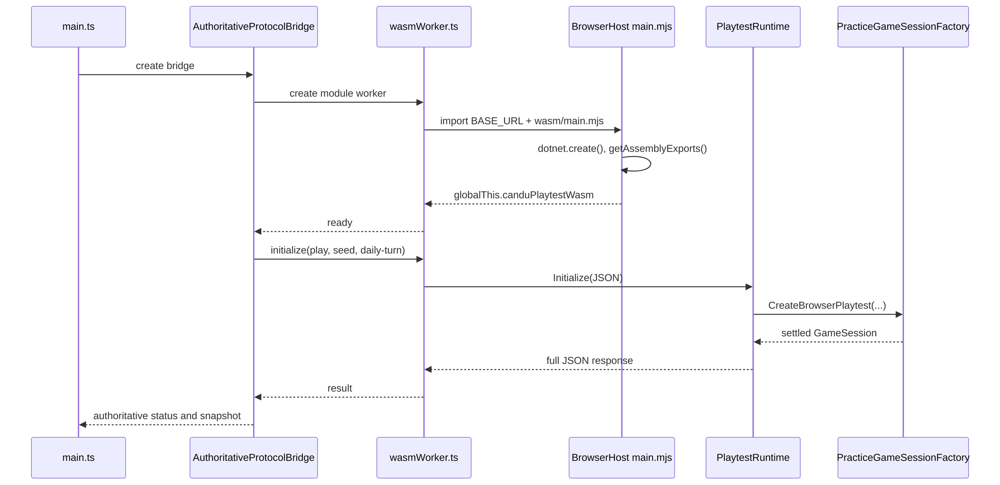

# 1. Entry points and startup

[Library](index.md) · [Next: commands and transport](02-browser-transport.md)

An **entry point** is the first operation invoked when a program or execution
context starts. CRS has a browser interface and a separate worker context that
loads the C# runtime. Its startup therefore crosses several entry points before
a reactor observation is available.

The **main thread** processes interface events and rendering. A **Web Worker**
is a separate JavaScript execution context reached through messages; placing
simulation work there allows the interface to remain responsive. The .NET host
runs inside that worker using WebAssembly, a browser-supported executable format.
The term **managed code** refers here to C# code executed under the .NET runtime,
which provides services such as memory management.

## There are three entry points

| Entry | Runs in | Purpose |
| --- | --- | --- |
| [index.html](../../web/candu-playtest/index.html) → [main.ts](../../web/candu-playtest/src/main.ts) | Browser main thread | Compose the application, session and UI |
| [wasmWorker.ts](../../web/candu-playtest/src/wasmWorker.ts) | Dedicated browser worker | Load WASM and execute queued requests |
| [main.mjs](../../src/ReactorSim.BrowserHost/main.mjs) → [BrowserExports.cs](../../src/ReactorSim.BrowserHost/BrowserExports.cs) | .NET runtime inside that worker | Expose managed JSON operations to JavaScript |

[Program.Main()](../../src/ReactorSim.BrowserHost/Program.cs) is deliberately empty.
The executable host needs a managed startup target, but gameplay enters through
the JavaScript exports. Starting a debugger at `Main()` alone will miss the
actual initialization and command path.

## Step 1: HTML creates the mounting and accessibility targets

`index.html` supplies `#game-root`, the hidden `#status-mirror`, and the polite
`#session-announcements` live region. Its module script loads `/src/main.ts`;
Vite resolves that source entry into the production build.

The game root receives the current native DOM/SVG view. The status mirror is
`aria-hidden` and exposes diagnostic text/data attributes to smoke tools. The
separate live region announces session changes to assistive technology.

## Step 2: main.ts composes long-lived objects

The statements in `main.ts` establish the following objects and lifecycle events
in source order:

1. `createCanduPlaytestBridge({ initialPacingMode: "daily-turn" })` starts the
   authoritative bridge lifecycle.
2. `new BridgeSessionController(bridge, {}, "daily-turn")` wraps it. The final
   argument requires daily pacing for this public client.
3. A session subscription updates bridge recovery, announcements and the smoke
   mirror whenever status or observations change.
4. `AppShell` mounts the launcher. `PlayerPanel` adds player/save controls, and
   `GameUpdateView` manages build/update discovery.
5. Update initialization receives Vite's base URL and production flag.
6. Visibility changes inform the controller. `beforeunload` destroys the update
   view, player panel and shell, then disposes the controller.

This file wires components together; it does not solve physics or own game rules.
Objects are created before WASM is ready so loading and recovery can be shown.

## Step 3: the bridge creates a worker and a loading observation

In [bridge.ts](../../web/candu-playtest/src/bridge.ts),
`createCanduPlaytestBridge()` returns `AuthoritativeProtocolBridge`.
Its initial active bridge is `UnavailableProtocolBridge`, paired with a
shape-compatible placeholder and loading status. That placeholder lets views
render their structure; its commands reject and its physics is not authoritative.

The lifecycle bridge creates `WorkerProtocolBridge`, which creates a module
worker using `new URL("./wasmWorker.ts", import.meta.url)`. It registers message
handlers and a startup deadline. Once the worker reports ready, the lifecycle
bridge requests initialization with a random core seed and daily pacing.

**Figure 2. Startup sequence.** This sequence diagram shows how the interface
obtains its first authoritative observation. Time proceeds downward. Each named
column represents a participant; solid arrows denote calls or requests, dashed
arrows denote returned information, and the host's self-arrow denotes work within
that participant. Asynchronous startup means that the interface can display a
loading state while these operations finish.

The first part constructs the bridge and loads the host. The worker's `ready`
message confirms that exports are available; it does not yet mean a reactor has
been created. The subsequent `Initialize(JSON)` request constructs and settles
the session, after which the full response travels back to the interface.
The diagram abbreviates the thin `BrowserExports`/`PlaytestBridgeV2` forwarding
calls between the worker and `PlaytestRuntime`.

In the Mermaid source, `participant` declares a column and `as` assigns its
display label. The opening `init` directive disables automatic width reduction
for this figure, allowing horizontal scrolling while keeping labels readable.
These statements control the documentation figure, not application startup.

## Step 4: the worker loads the .NET host

`loadWasm()` builds its module URL from `import.meta.env.BASE_URL`, so the Pages
subpath `/CRS/` is part of asset resolution. It imports `wasm/main.mjs`, locates
the exported facade through `findWasmExports()`, and reports either `ready` or
`load-error`.

The host's `main.mjs` imports `_framework/dotnet.js`, creates the runtime, reads
its main assembly name and fetches assembly exports. It then assigns a small
`globalThis.canduPlaytestWasm` object. Each function forwards a JSON string to a
`[JSExport]` method in `BrowserExports`. Finally it runs managed `Main()`.

The exports delegate to
[PlaytestBridgeV2](../../src/ReactorSim.Browser/PlaytestBridge.cs), a static facade
over one default `PlaytestRuntime`. Tests and tools can instantiate independent
runtimes; the facade does not make all runtimes share a session.

## Step 5: the Browser layer validates initialization

[PlaytestRuntime.Initialize()](../../src/ReactorSim.Browser/PlaytestRuntime.cs)
parses the JSON request and checks protocol, mode, seed, objective and pacing.
The supported game mode is `play`. The seed is a 32-bit unsigned value at the
browser boundary. Invalid requests produce diagnostics rather than silently
selecting another mode.

The runtime constructs a candidate session before replacing its current runtime.
Its session is lazy: merely obtaining capabilities does not construct a full core.
This keeps a solver initialization error from being hidden inside a managed
type-initializer failure.

## Step 6: the Game factory creates the initial reactor

[PracticeGameSessionFactory.CreateBrowserPlaytest()](../../src/ReactorSim.Game/PracticeGameSessionFactory.cs)
delegates to `CreateBrowserSession()` and `CreateSession()`. A **factory** is a
function or class responsible for constructing an object with its required
dependencies. This factory establishes a consistent initial session in the
following order:

1. Build the time model, retained playback modes and `PracticeRunClock`.
   Free practice is endless with unlimited stock; the challenge has a finite
   horizon and stock.
2. Load `FullCoreDiffusionDataPackV1` from the embedded authored pack and create
   `FullCoreDiffusionModelV1` for the CANDU topology.
3. Create the seeded aged bundle inventory using
   `SyntheticGameCoreStateV1.CreateAgedPractice(seed)`.
4. Create `EquilibriumCoreSolverV1` at the 2,064 MW thermal reference output.
5. Create the fourteen-zone reactor regulating-system (RRS) mapping and initial
   RRS state. This controller calculates the liquid-zone response used to regulate
   the model's neutron balance and power distribution.
6. Run RRS equilibrium and commit the projection. A bounded additional settling
   loop reduces initial net reactivity without advancing run time or using fuel.
7. If the pack supplies a xenon reference, iterate assumed pre-run poison
   equilibrium and RRS together. Failure to settle raises an actionable error;
   the factory does not return a partly settled reactor.
8. Construct `GameSession` with inventory, solver, RRS, clock and poison.
9. For daily browser play, `UseDailyTurns()` selects daily pacing and pauses the
   clock. Challenge setup also pauses before play.

The **seed** is an integer used to make the initial aged inventory reproducible.
The authored pack and algorithms determine
the subsequent numerical result. Retrying with the same seed and objective
recreates the same initial conditions; drawing a seed is browser input generation,
not simulation randomness added during a day.

## Step 7: readiness unlocks the launcher

The lifecycle bridge parses the first snapshot and checks daily pacing and
`practice-daily-one-step-v1` cadence identity. Only then does it switch to the
worker as the active bridge and publish authoritative status. Errors make the
bridge unavailable; they never activate a TypeScript simulation.

[AppShell](../../web/candu-playtest/src/AppShell.ts) initially owns a
`LauncherView`. `showStudio()` or `showArcade()` destroys the prior view, calls
`session.startShift()`, and mounts the new view over the same controller.
The launcher prepares the challenge before entering Arcade. Switching from Arcade
to Studio preserves the live session and shared draft.

`startShift()` does not start a daily timer. For an untouched daily run it issues
a no-time `pause` command so the save journal has an authoritative digest even
before the first day.

If startup stalls, work upward from the worker's load error, host asset URL and
factory diagnostic. [Chapter 7](07-development.md) maps common symptoms to these
boundaries.
