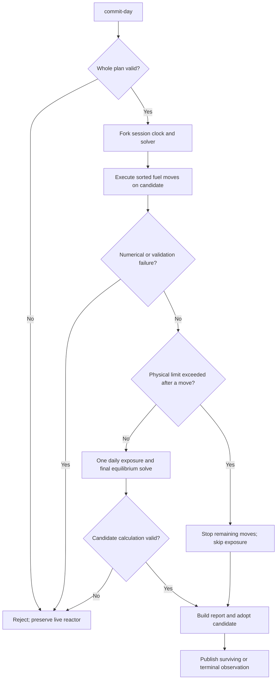

# 3. One complete daily turn

[Previous: transport](02-browser-transport.md) · [Library](index.md) · [Next: Core physics](04-core-physics.md)

In CRS, a **daily turn** is one submitted fuel plan followed, when the run remains
eligible to advance, by a single simulated-day update. Its implementation treats
the calculation as a transaction: related changes are calculated together before
being adopted as live state. A **candidate** is the provisional session used for
this calculation. The implementation is concentrated in
[GameSession.cs](../../src/ReactorSim.Game/GameSession.cs). The public semantics
are specified in [daily-turn mode](../gameplay/daily-turn-mode.md).

## Step 1: inspect and draft without moving time

Studio and Arcade read the same `CanduSnapshot`. Selecting a channel changes view
selection. Adding/removing it calls the controller's `setDailyPlan()`. The
snapshot's published refuelling plan supplies inserted, retained and outgoing
positions, so the client can show an exit preview without predicting a new
reactivity or power solution.

Studio sends `commit-day` from its commit action. Arcade first shows review, then
sends the same command on confirmation. Both send the current
`expectedCompletedDays` and a copy of the channel indices. An empty array is a
valid request to advance without refuelling.

## Step 2: validate the whole plan

`CommitDay()` is the synchronous managed convenience path: call `BeginDay()`,
call `CalculateDay()`, return the result. The worker's yielding API uses those
same operations separately.

`ValidateDailyPlan()` checks, in order:

1. The run is not terminal and uses daily pacing.
2. The submitted day equals `_completedDays`.
3. The list has at most 380 entries, every index is in 0–379, and there are no
   duplicates.
4. Every selected channel is eligible to refuel.
5. Finite stock covers the **entire** list at eight fresh bundles per channel.
6. The day counter can increment without overflow.

The authoritative list is sorted by numeric channel index. The UI also displays
canonical order. Caller insertion order is not an execution-order contract.
Failure returns a rejected result against the live observation before any fuel
is spent.

## Step 3: detach the candidate

`BeginDay()` clones the session, forks `PracticeRunClock`, and forks
`EquilibriumCoreSolverV1`. Immutable inventory and state values can be shared
until replaced. `_executingDay` lets the candidate use `RefuelChannel()` even
though daily sessions normally reject immediate individual refuelling.

All fuel moves occur on this candidate. The original session remains the accepted
reactor. If a later numerical operation fails, the whole candidate can be discarded,
including earlier candidate movements.

**Figure 3. Daily transaction outcomes.** Rectangles represent operations or
results, diamonds represent decisions, and labelled arrows identify each branch.
The figure summarizes repeated fuel-move checks as one stage; in the implementation,
each sorted move is evaluated before proceeding to the next.



The rejection branches all lead to preservation of the live session because
their work exists only on the detached candidate. The physical-limit branch
instead reaches report construction and adoption: it describes a validly
calculated reactor that has left the game's operating envelope. That distinction
explains why an accepted response can describe a lost run. The ordinary path
reaches exposure only after the fuel moves have finished without a physical loss.

In the Mermaid source, `flowchart TD` requests a top-to-bottom layout, square
brackets define operation boxes, braces define decision diamonds, and
`-->|Yes|` or `-->|No|` adds a branch label. This notation describes control flow;
it does not execute the transaction.

## Step 4: execute each eight-bundle movement

`BeginDay()` visits sorted channels until the candidate becomes terminal.
`RefuelChannel()` performs these steps:

1. Validate direction syntax, channel eligibility, index and the required
   eight-bundle shift.
2. Replace the requested direction with the channel's actual flow from
   `Candu6CoreTopologyFactoryV1`. The placeholder direction passed by `BeginDay()`
   is not the final movement direction.
3. Call Core's `SyntheticGameCoreStateV1.TryRefuel()` to create a new inventory
   plus inserted and discharged bundle records.
4. In `TryBuildRefuellingTransaction()`, rebind poison by bundle identity and run
   a new equilibrium/RRS solve for the candidate inventory at the same time.
5. Commit that spatial candidate to the detached solver, then apply its inventory,
   poison, RRS and projection metadata.
6. Record `RefuellingMovement`, discharge burnup, consumed fuel and useful-bundle
   counts. Useful discharge uses the shared challenge threshold.

The move changes the next move's starting power and control state. It consumes no
simulation time. A physical loss after one accepted move stops the remainder,
but keeps that move in the eventually adopted report.

Core's generic plan supports four- and eight-bundle shifts; the active Game path
requires eight. See [chapter 4](04-core-physics.md) for the actual position mapping.

## Step 5: guard against a stale candidate

`DailyTurnOperation` retains the owner's original clock reference/generation,
inventory reference and spatial projection reference. `CalculateDay()` compares
them with the live owner before adoption work. A changed owner produces
`GameSession.Day.StaleCandidate` instead of overwriting newer state.

This protects the transaction even for direct managed users. Worker serialization
also prevents ordinary public UI commands from interleaving with a day.

## Step 6: integrate one large interval

If candidate fuel moves have not already ended the run, `CalculateDay()` plans a
simulation step toward `start + 86_400`. `TryBuildDailyAdvance()` requires exactly
one positive segment of at most 86,400 seconds, beginning at the current time.

It uses the **post-refuelling** accepted shape and operating amplitude for the
whole segment:

1. Analytically advance iodine/xenon once using that shape/flux and duration.
2. Compute per-node fission energy as `shapePowerWatts × amplitude × seconds`.
3. Apply those energies to bundle burnup through `TryAddFissionEnergy()`.
4. Bind poison's burnup-dependent reference to the exposed inventory.
5. Add thermal energy and operating score for the interval.
6. Move the RRS time stamp to the segment end and update projection versioning.
7. `TryBuildScheduledShape()` runs equilibrium/RRS with updated burnup and poison
   at the day boundary.
8. Freeze a `PracticeCandidate` containing all replacement values.

There are no intraday observations or intermediate operating-limit checks during
that exposure interval. The final equilibrium/control calculation can internally
perform many numerical solves; “one day step” does not mean one Jacobi iteration.

`CalculateDay()` commits the final projection and clock **on the detached session**,
then applies its candidate values. Any numerical rejection still leaves the live
owner untouched.

## Step 7: report and adopt

On a full 86,400-second advance, increment `_completedDays`. An early fuel-move
loss does not count a completed day. The retained clock can cap a comparison run
at its scenario horizon; normal public daily runs use an endless horizon or the
one-day challenge.

[DailyTurnResult](../../src/ReactorSim.Game/DailyTurnResult.cs) captures requested,
executed and unexecuted channels; every confirmed movement; score/energy/fuel
deltas; ending LZC/tilt; and ending reason. Its arrays are copied into read-only
collections. `AdoptDailyCandidate()` transfers the completed reactor state and
counters to the live owner together.

The Browser layer maps this result into JSON. The controller replaces its
observation, clears the accepted draft, records the journal and notifies views.
Studio's `DayCalculationView` displays completion/rejection/interruption; Arcade
shows its shared challenge result.

## What each outcome means

| Outcome | Fuel/time retained | Result to interpret |
| --- | --- | --- |
| Invalid plan, stale day, insufficient stock | None | Rejected; revise and resubmit against the current observation |
| Numerical failure in a move or final solve | None from the attempted day | Rejected; live owner preserved |
| Limit violation after a fuel move | Accepted moves through the violating move; no daily exposure | Accepted terminal outcome; remaining channels unexecuted |
| Limit violation at day end | Completed movements and daily update | Accepted terminal outcome with day report |
| Surviving day | All accepted work | Accepted; inspect the next frozen decision |
| Worker interruption / unreadable response | Cannot infer from the missing response | Transport error; not evidence of a physical loss or safe retry |

## Limits, score and the objective

[PracticeOperatingLimits](../../src/ReactorSim.Game/PracticeOperatingLimits.cs)
ends a run below 10%/above 90% mean LZC, above 20% absolute global tilt, above
7,300 kW/channel or above 935 kW/bundle. Exact equality is allowed; mean-level
checks include a tiny floating-point summation tolerance. Controller exhaustion
and numerical diagnostics are separate concepts.

[PracticeScoring](../../src/ReactorSim.Game/PracticeScoring.cs) compares each
channel's power with its fixed reference. **Root-mean-square (RMS) relative
deviation** is obtained by squaring each channel's fractional error, averaging
those squares with equal weight per channel, and taking the square root.
Squaring prevents positive and negative deviations from cancelling.

**Equation 1. Operating points for a constant-shape interval.** This mathematical
notation expresses how the score depends on interval duration and RMS deviation:

```text
points = (seconds / 3600) / (1 + (RMS / 0.10)^2)
```

Here, `seconds` is the simulated interval length, division by `3600` converts it
to hours, and `points` is the resulting score increment. In this mathematical
notation, `^2` denotes squaring. `RMS` is dimensionless:
`0.10` represents a 10% RMS deviation. The denominator is at least one and grows
with the square of the deviation, so larger deviations reduce the earning rate.

For a hypothetical 24-hour interval, `RMS = 0` yields 24 points,
`RMS = 0.10` yields `24 / 2 = 12` points, and `RMS = 0.20` yields
`24 / 5 = 4.8` points. These examples illustrate the formula; they do not imply
that a particular reactor state can achieve zero deviation while remaining
within its operating limits.

The daily interval uses its post-refuelling shape for this integral. A fuel move
has no direct bonus or cost in policy `practice-channel-ripple-v3`, even though
legacy-named breakdown fields remain in reports. Its power response changes later
operating score. `ShiftProgress` decides challenge progress and badges; the UI
does not award them. See the [score policy](../gameplay/score-balance.md) and
[power-limit contract](../gameplay/power-limits.md).
