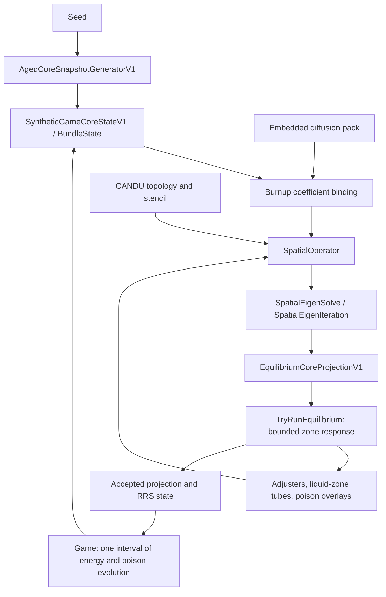

---
hide:
  - toc
---

# 4. Core state and physics

[Previous: daily turn](03-daily-turn.md) · [Library](index.md) · [Next: presentation](05-presentation.md)

Core is the deterministic numerical and inventory library. **Deterministic**
means that the same validated inputs and model identities are intended to produce
the same calculated result. **Inventory** describes the fuel bundles and their
locations, while the numerical model calculates power and related reactor
measurements from that inventory. Its
[project](../../src/ReactorSim.Core/ReactorSim.Core.csproj) targets
`netstandard2.1`; the browser host consumes it through Game and Browser. No
external analysis program is loaded to calculate a player's day.

## Data flow through the numerical model

**Figure 4. Numerical dependencies and feedback.** This diagram connects the
initial fuel inventory, material data, spatial solution and control response.
Arrows identify data dependencies or feedback between stages; they do not
represent a physical flow of fuel or coolant.



The left-hand input path begins with the seed, which determines the aged fuel
inventory. Each bundle's material and burnup select coefficients from the pack.
Those coefficients, the topology and additional absorption contributions define
the operator used by the spatial solver. The resulting projection gives the
controller a power distribution to evaluate.

The short loop from RRS through device absorption back to the operator represents
trial liquid-zone adjustments and repeated equilibrium solves. The longer path
through interval energy changes the fuel's exposure for a subsequent decision.
These loops have different purposes and occur at different stages of a turn;
the figure does not imply that every arrow runs once. In Mermaid, `flowchart TD`
selects a vertical layout and `-->` draws a directed relationship between nodes.

## 4.1 Identity, topology and array ordering

[Identifiers.cs](../../src/ReactorSim.Core/Domain/Identifiers.cs),
[TopologyContracts.cs](../../src/ReactorSim.Core/Domain/TopologyContracts.cs) and
[Candu6CoreTopologyContracts.cs](../../src/ReactorSim.Core/Domain/Candu6CoreTopologyContracts.cs).
They separate channel identity, physical position, persistent bundle identity,
neighbors and boundary faces.

The active model has 380 channels and 12 bundle positions per channel: 4,560
nodes. Positions run physically from End A (`0`) to End B (`11`), regardless of
fuel flow. A **flat array** stores these two coordinates in one sequence of
values. The active arrays are **channel major**, meaning that all twelve
positions of one channel precede the positions of the next channel.

**Example 2. Conversion between spatial coordinates and a flat array index.**
The following explanatory notation maps a channel/position pair to its storage
index and recovers the two coordinates:

```text
nodeIndex = channelIndex * 12 + position
channelIndex = nodeIndex / 12       (integer division)
position = nodeIndex % 12
```

`channelIndex` lies between 0 and 379, `position` between 0 and 11, and
`nodeIndex` between 0 and 4,559. Multiplication by twelve skips the complete
channels preceding the selected channel. Integer division discards the remainder
to recover the channel, while `%` is the remainder operator used to recover the
position. For example, channel 2, position 5 gives `2 * 12 + 5 = 29`;
`29 / 12` with integer division returns 2, and `29 % 12` returns 5.
The notation explains storage order; it is not a complete function with bounds
checking.

A bundle ID follows a physical bundle as it moves. A `NodeKey` identifies a slot.
They are not interchangeable. Grid row/column and a visible channel name are
presentation coordinates/labels; adjacency comes from the explicit topology.
Neighboring channels have opposite flow direction.

[SpatialStencilContracts.cs](../../src/ReactorSim.Core/Domain/SpatialStencilContracts.cs)
binds explicit neighbor and boundary relationships for numerical evaluation.
Reflective faces have zero boundary conductance. The active nonreflective axial
ends use the v8 Marshak conductance; radial leakage is separately authored.
The [topology specification](../spec/topology-indexing-units-boundaries-v1.md)
defines general indexing invariants, and the [v8 notes](../physics/axial-marshak-v8.md)
describe the current concrete boundary treatment. Older specification status labels do
not override the current implementation guide or pack version.

## 4.2 Bundle inventory and aged starts

[BundleInventory.cs](../../src/ReactorSim.Core/Domain/BundleInventory.cs) defines
bundle records and inventory contracts. The active game inventory is
`SyntheticGameCoreStateV1` in
[GameRefuellingContracts.cs](../../src/ReactorSim.Core/Domain/GameRefuellingContracts.cs).
Its historical `Synthetic` name remains even though live burnup binds into the
shared spatial model.

The state records bundles by channel/slot, available fresh stock, next stable
fresh-bundle sequence, operation count and recent movement metadata. Methods
return replacement state values rather than modifying an accepted channel array
in place.

`CreateAgedPractice(seed)` calls
[AgedCoreSnapshotGeneratorV1](../../src/ReactorSim.Core/Domain/AgedCoreSnapshotGeneratorV1.cs).
It produces a seeded aged inventory with refuelling-history-inspired burnup
distribution. Startup settlement then computes consistent initial power and
poison/control observations. The assumptions and residence intervals are in
[aged-core starts](../physics/aged-core-starts.md).

### A concrete eight-bundle shift

`GameRefuellingPlanV1` supplies the same position lists used by execution and
published preview. For movement toward End B:

| Role | Old positions | New positions |
| --- | --- | --- |
| Fresh bundles | Outside the channel | 0–7 |
| Retained bundles | 0–3 | 8–11 |
| Discharged bundles | 4–11 | Outside the channel |

Toward End A reverses the roles: old 0–7 discharge, old 8–11 move to 0–3, and
fresh bundles occupy 4–11. These are zero-based physical positions, not display
numbers 1–12.

`TryRefuel()` validates stock, coordinates, time, type and shift; clones the
outer inventory array; replaces the affected channel; creates fresh IDs; moves
retained records without changing identity; returns discharged records; and
updates finite stock/counters. Unlimited stock does not remove consumption
accounting in Game. Fresh bundles begin with zero accumulated fission energy.

### Read the position mapping itself

The constructor below is used by execution and previews. For an eight-bundle move
toward End B, it inserts at 0–7, moves retained bundles from 0–3 to 8–11, and
discharges the old 4–11. Reversing direction reverses which end receives fresh fuel.

```annotated-source
path: src/ReactorSim.Core/Domain/GameRefuellingContracts.cs
title: One authoritative refuelling position map
language: csharp
start: public GameRefuellingPlanV1(GameRefuellingDirectionV1 direction, ushort shiftCount)
end: 'RetainedToPositions = Array.AsReadOnly(RetainedFromPositions.Select(i => towardB ? i + shiftCount : i - shiftCount).ToArray());

  }'
steps:
- through: throw new ArgumentOutOfRangeException(nameof(shiftCount));
  explanation: '**Validate the generic contract.** Core accepts only known directions and shifts of four or eight bundles. The public Game path further requires eight. Throwing here prevents constructing an internally inconsistent map.'
- through: 'OutgoingEnd = towardB ? "B" : "A";'
  explanation: '**Name the movement and its ends.** The enum becomes a stable wire/display ID. `towardB` controls the ternary expressions: movement toward B enters at A and exits at B; movement toward A does the reverse.'
- through: 'DischargedPositions = Array.AsReadOnly(Enumerable.Range(towardB ? 12 - shiftCount : 0, shiftCount).Select(i => (uint)i).ToArray());'
  explanation: '**Choose fresh and outgoing slots.** `Enumerable.Range(start, count)` constructs consecutive positions. Insertion uses the incoming end, discharge uses the outgoing end. The integer values become unsigned positions and read-only arrays so consumers share a fixed map.'
- through: 'RetainedToPositions = Array.AsReadOnly(RetainedFromPositions.Select(i => towardB ? i + shiftCount : i - shiftCount).ToArray());

    }'
  explanation: '**Map surviving bundle positions.** The remaining `12 - shiftCount` bundles move by exactly the shift length. Adding shifts toward B; subtracting shifts toward A. Identity follows the retained bundle even though its slot changes.'
```

### Apply that map to replacement inventory

This is the movement section of `TryRefuel`, after its argument and stock checks.
The old channel remains the source of retained and discharged bundles.

```annotated-source
path: src/ReactorSim.Core/Domain/GameRefuellingContracts.cs
title: Create fresh bundles and move retained identities
language: csharp
start: BundleState[][] nextChannels = (BundleState[][])_channels.Clone();
end: shiftCount, UnlimitedFreshFuel);
steps:
- through: var discharged = new BundleState[shiftCount];
  explanation: '**Allocate replacement containers.** Clone the outer channel array, then allocate a new array for the changed channel and separate movement reports. Other channel arrays can be shared because this operation replaces bundle state instead of mutating accepted arrays.'
- through: uint position = plan.InsertedPositions[(int)index];
  explanation: '**Use the shared plan.** Each loop iteration takes the next insertion slot from the authoritative map. The same map can be projected to the player before committing the move.'
- through: simulationTimeSeconds);
  explanation: '**Construct a fresh bundle.** Its stable ID comes from the next fresh-bundle sequence, followed by channel and physical position, trimmed material ID, zero initial burnup and cumulative energy, heavy-metal mass, and insertion time. Fresh identity is distinct from the slot identity.'
- through: 'inserted[index] = fresh;

    }'
  explanation: '**Place and report each insertion.** The target channel receives the new bundle at its physical position, and the inserted list retains the same value for the movement report.'
- through: 'target[to] = Move(source[from], channelIndex, to);

    }'
  explanation: '**Move retained bundles without replacing their identities.** Parallel from/to maps specify the new slot of each surviving old bundle. `Move` updates location while carrying that bundle''s existing fuel history.'
- through: discharged[index] = source[plan.DischargedPositions[index]];
  explanation: '**Capture the outgoing old bundles.** Discharge records come from the original channel, so their identities and exit burnup remain available after replacement.'
- through: shiftCount, UnlimitedFreshFuel);
  explanation: '**Assemble the new core inventory.** Replace only the selected channel. Finite stock decreases by the inserted count; unlimited practice retains stock policy. Checked counters advance operation count and fresh-ID sequence, rejecting arithmetic overflow. The returned core is still a candidate until Game completes its equilibrium transaction.'
```

## 4.3 Energy and burnup

`TryAddFissionEnergy()` consumes one energy value per node in canonical order.
The daily caller supplies watts multiplied by operating amplitude and seconds.
**Burnup** measures how much thermal fission energy a fuel bundle has produced
per unit of its heavy-metal mass. It allows bundles of different exposure
histories to be compared on an energy-per-mass basis.

**Equation 2. Bundle burnup and its display-unit conversion.** The first
relationship adds energy accumulated during the run to the bundle's initial
burnup; the second relates the internal and displayed units:

```text
currentBurnupJPerKgHm = initialBurnupJPerKgHm
                      + cumulativeFissionEnergyJ / heavyMetalMassKg
1 MWd/kg = 8.64e10 J/kg
```

`initialBurnupJPerKgHm` describes exposure already assigned when the bundle was
created. `cumulativeFissionEnergyJ` is subsequently accumulated energy in joules,
and `heavyMetalMassKg` is heavy-metal mass in kilograms. Dividing energy by mass
produces J/kg, the same units as the initial burnup, so the two terms can be
added. The conversion follows from one megawatt being one million joules per
second and one day containing 86,400 seconds. Thus one MWd/kg equals
`1,000,000 * 86,400 = 8.64e10` J/kg. Dividing internal burnup by this factor gives
the displayed MWd/kg value.

The active fresh bundle mass is 20.6 kg HM. Inventory energy/burnup updates
advance state versions and preserve bundle identity. The 650 MW electrical
reference is used to estimate displayed electrical energy from the 2,064 MW
thermal reference; it is not the energy input to burnup.

### Follow one exposure update through the bundles

This loop runs after `TryAddFissionEnergy` has checked that exactly 4560 increments
were supplied. Its ordering is the channel-major ordering described above.

```annotated-source
path: src/ReactorSim.Core/Domain/GameRefuellingContracts.cs
title: Validate and apply per-bundle thermal energy
language: csharp
start: BundleState[][] nextChannels = new BundleState[ChannelCount][];
end: 'nextChannels[channelIndex] = target;

  }'
steps:
- through: double delta = deltaFissionEnergyJ[index++];
  explanation: '**Walk channel-major input.** Allocate the replacement core, then visit every channel and position. `index++` reads the current energy increment before advancing the flat index. Thus channel 0 consumes the first twelve entries, channel 1 the next twelve, and so on.'
- through: '"Burnup energy increments must be finite, canonical, and nonnegative SI joules.");

    }'
  explanation: '**Reject invalid input energy.** Every increment must satisfy the canonical nonnegative-number contract. The diagnostic path includes the flat input index, identifying the bad value. Early return leaves the accepted core unchanged.'
- through: '"Burnup integration would make cumulative fission energy non-finite.");

    }'
  explanation: '**Check accumulated energy as well.** Add the increment to the bundle''s prior lifetime energy, then validate the sum. Two individually valid numbers can still overflow when added.'
- through: ': source[position].WithEnergy(cumulative);

    }'
  explanation: '**Retain or replace each bundle state.** A zero increment reuses the old value. Otherwise `WithEnergy` creates its updated energy/burnup state while preserving bundle identity. The conditional avoids unnecessary replacement for unchanged fuel.'
- through: 'nextChannels[channelIndex] = target;

    }'
  explanation: '**Store the completed replacement channel.** Once its twelve positions are valid, place the channel array in the new outer array. The following return wraps this inventory with unchanged stock and refuelling metadata.'
```

## 4.4 Authored packs and coefficient binding

[FullCoreDiffusionDataPackContracts.cs](../../src/ReactorSim.Core/Domain/FullCoreDiffusionDataPackContracts.cs)
loads and validates the embedded pack, including units, group order, material
tables, conductances and convergence policy.
[BurnupCoefficientContracts.cs](../../src/ReactorSim.Core/Domain/BurnupCoefficientContracts.cs)
owns the table-binding/interpolation contracts. In the active path,
`FullCoreDiffusionModelV1.BuildCoefficientSet()` binds each bundle's material and
current burnup to its slot coefficients.

The groups are always **fast, thermal**, in that order. Absorption and
macroscopic production/scatter coefficients use inverse metres, conductances
square metres, volume cubic metres, and power watts. These units and group order
are part of the binding contract: interchanging groups or supplying a display-unit
value as a coefficient input would change the numerical problem.

The canonical diffusion file is
[data/packs/candu6-two-group-diffusion-pack-v1.json](../../data/packs/candu6-two-group-diffusion-pack-v1.json).
Its runtime copy is embedded in Core. A Core MSBuild target compares the files'
hashes and fails the build on drift. `tools/Sync-PhysicsPacks.ps1 -Stage` stages
canonical data; external reference files are provenance and analysis inputs,
not runtime services. The IQS metadata pack remains embedded for mathematical
dependencies; it does not make a separate kinetics engine the public game loop.

## 4.5 The two-group solve, step by step

The solve is organized across the following files, listed in dependency order:

1. [FullCoreDiffusionModelContracts.cs](../../src/ReactorSim.Core/Domain/FullCoreDiffusionModelContracts.cs):
   `TryCreateCandu6()` builds the model; `TrySolve()`/prepared solve paths bind
   coefficients, overlays and warm starts.
2. [SpatialOperatorContracts.cs](../../src/ReactorSim.Core/Domain/SpatialOperatorContracts.cs):
   the matrix-free operator combines local removal and neighbor/boundary leakage.
3. [SpatialEigenIterationContracts.cs](../../src/ReactorSim.Core/Domain/SpatialEigenIterationContracts.cs):
   `SpatialEigenIteration.TryStep()` performs a two-group source iteration and
   inner linear solves.
4. [SpatialConvergenceContracts.cs](../../src/ReactorSim.Core/Domain/SpatialConvergenceContracts.cs):
   `SpatialEigenSolve` manages outer convergence and diagnostics.
5. [EquilibriumCoreSolverContracts.cs](../../src/ReactorSim.Core/Domain/EquilibriumCoreSolverContracts.cs):
   `EquilibriumCoreSolverV1` creates candidate projections and validates commit.

**Neutron flux** describes the intensity of neutron motion through an area,
expressed here per square metre per second. The two-group approximation separates
that flux into fast and thermal components. An **eigenvalue problem** seeks a
spatial flux distribution and a multiplier, effective `k`, that satisfy the
neutron-balance equations together. An **iteration** refines an initial guess;
**convergence** means that the specified numerical error criteria have been met.

For one outer iteration, the solver builds neutron production from the current
two-group flux, solves the fast group, builds the thermal source from downscatter
and fission, then solves the thermal group. It updates effective `k` from the
volume-weighted production ratio and rescales both flux groups to target fission
power. It evaluates eigenvalue change, equation residual, source-shape change and
power balance before accepting convergence.

The inner solve uses deterministic Jacobi corrections with a positive diagonal.
The **Jacobi method** updates each flux estimate using the previous iteration's
values and the local equation error divided by its diagonal coefficient. It
allows the operator to be applied through the node/neighbor structure without
constructing a dense matrix of every possible node pair.
`Sigma_f` converts flux into fission power; `nuSigma_f` produces neutrons. They
are distinct inputs. The active model includes fast-to-thermal downscatter and
no upscatter term.

**Equation 3. Two-group neutron balance and fission power.** The first two lines
express the fast and thermal balance equations at a spatial node. The third
defines neutron production, and the final line sums fission power over all nodes.
Node subscripts are omitted to keep the notation readable:

```text
L1(phi1) = chi1 * F / k
L2(phi2) = Sigma_s12 * phi1 + chi2 * F / k
F = nuSigma_f1 * phi1 + nuSigma_f2 * phi2
P = sum(volume * E_fission * (Sigma_f1 * phi1 + Sigma_f2 * phi2))
```

The quantities in this notation have the following meanings:

| Symbol | Meaning |
| --- | --- |
| `phi1`, `phi2` | Fast and thermal neutron flux at a node |
| `L1`, `L2` | Operators representing neutron removal and spatial leakage in each group |
| `chi1`, `chi2` | Fractions of fission neutrons entering each energy group |
| `F` | Local neutron-production source from fission |
| `k` | Effective multiplication eigenvalue of the solved neutron balance |
| `Sigma_s12` | Macroscopic fast-to-thermal scattering coefficient |
| `nuSigma_f1`, `nuSigma_f2` | Group fission coefficients weighted by neutron yield, used to calculate production |
| `Sigma_f1`, `Sigma_f2` | Group fission coefficients used to calculate the fission rate |
| `volume` | Spatial node volume in cubic metres |
| `E_fission` | Energy released per fission, in joules |
| `P`, `sum(...)` | Total thermal fission power in watts and its sum over all spatial nodes |

`L1` includes fast absorption and downscatter removal; `L2` includes thermal
absorption. Both include explicit leakage. The additional `Sigma_s12 * phi1`
term in the thermal equation accounts for fast neutrons entering the thermal
group by downscatter. In the power expression, multiplying a macroscopic fission
coefficient by flux gives a fission rate per volume. Multiplication by volume and
energy per fission gives joules per second, or watts.

These relationships describe a balance at a solved state, rather than a
time-integration procedure. The daily exposure update is a separate operation
that uses the resulting power and flux. See the
[active equations](../physics/active-two-group-solver.md) for the complete operator,
normalization and convergence criteria; this walkthrough does not introduce a
second numerical specification.

`TrySolveCandidate()` can reuse the current spatial solve as a warm start.
Prepared candidate work avoids rebinding unchanged coefficients for repeated
controller trials. `TryCommitCandidate()` checks candidate compatibility before
replacing the accepted projection. A converged trial is not accepted game state
until its surrounding transaction also succeeds.

### Read the inner spatial iteration

The excerpt below is the Jacobi iteration inside the two-group solver, after
source, starting guess and operator application have been validated. For a chosen
energy group, it solves `A × flux = source`. Here `solution` is the current flux,
`applied` is the operator applied to it, and `diagonal` is the diagonal of `A`.
This inner solve sits inside the larger two-group/eigenvalue calculation described
above; it is not the complete day calculation.

```annotated-source
path: src/ReactorSim.Core/Domain/SpatialEigenIterationContracts.cs
title: Correct flux and test the numerical residual
language: csharp
start: for (int innerIteration = 0;
end: 'Array.Copy(candidate, solution, solution.Length);

  }'
steps:
- through: double next = solution[nodeIndex] + correction;
  explanation: '**Form a Jacobi correction.** The outer loop is bounded by numerical policy. For each node, subtract the current operator result from the required source, divide by the diagonal coefficient and add that correction to the current flux. Each node reads the previous iteration''s `applied` values.'
- through: '"The deterministic Jacobi update produced a non-finite flux.");

    return false;

    }'
  explanation: '**Reject numerical overflow or invalid arithmetic.** Both the correction and proposed flux must be finite. The diagnostic identifies the affected node; returning `false` prevents this inner result from being treated as a converged solution.'
- through: 'candidate[nodeIndex] = next;

    }'
  explanation: '**Enforce nonnegative neutron flux.** A negative proposal is invalid. Valid proposals go into a separate `candidate` buffer, so later nodes do not accidentally use partially updated values from this same iteration.'
- through: 'diagnostic = operatorDiagnostic;

    return false;

    }'
  explanation: '**Evaluate the candidate with the spatial operator.** `TryApply` writes `A × candidate` into `applied`. If that calculation fails, its diagnostic is propagated. This reevaluation is needed to measure how well the proposed flux satisfies the equation.'
- through: double rowScale = Math.Abs(applied[nodeIndex]) + Math.Abs(source[nodeIndex]);
  explanation: '**Measure equation mismatch.** The residual at a node is `applied - source`. Absolute difference measures error magnitude; row scale measures the magnitudes of the compared terms. Both are evaluated over every spatial node.'
- through: 'scale = Math.Max(scale, rowScale);

    }'
  explanation: '**Validate and collect the worst mismatch.** Reject non-finite residual calculations. Taking maxima yields an infinity-norm error and a scale over all nodes, preventing a small average from hiding a large local mismatch.'
- through: '"The deterministic inner relative residual became non-finite.");

    return false;

    }'
  explanation: '**Normalize the residual.** If both terms have zero scale, relative error is defined as zero. Otherwise divide worst absolute residual by the scale and require a finite result. This makes a relative tolerance meaningful across different source magnitudes.'
- through: 'Array.Copy(candidate, solution, solution.Length);

    }'
  explanation: '**Accept convergence or continue.** Meeting either the absolute or relative policy tolerance copies the candidate into the output, clears the diagnostic and returns success. Otherwise copy it as the next starting guess and repeat. If the bounded loop exhausts, the following code reports nonconvergence rather than accepting an unconverged answer.'
```

## 4.6 Poison follows bundle identity

[PracticeXenonContracts.cs](../../src/ReactorSim.Core/Domain/PracticeXenonContracts.cs)
contains the analytic iodine/xenon update and `PracticeXenonStateV1`.
`Advance()` evolves inventories at fixed interval flux/power. `Rebind()` matches
the new core's bundle IDs after refuelling: retained fuel carries its poison and
fresh fuel receives zero iodine and xenon. `BindBurnupReference()` updates the
burnup-dependent reference basis after exposure.

`BuildOverlay()` converts poison's deviation from the authored reference into
absorption changes for the spatial solve. This reference replacement matters:
adding an independent absolute poison term on top of a table already containing
a reference would change the calibration basis. The implementation's assumptions
are documented in [xenon reference v6](../physics/xenon-reference-v6.md) and
[iodine/xenon gameplay](../physics/iodine-xenon-gameplay.md).

Game retains current and coupled poison state so presentation can describe the
inventories and the poison basis used by the accepted projection. Channel
averages cannot reconstruct individual bundle histories; the browser therefore
consumes published poison observations.

## 4.7 Adjusters, liquid zones and equilibrium control

[PracticeAdjusters.cs](../../src/ReactorSim.Core/Domain/PracticeAdjusters.cs)
provides the fixed adjuster geometry/absorption contribution.
[PracticeLiquidZoneTubes.cs](../../src/ReactorSim.Core/Domain/PracticeLiquidZoneTubes.cs)
describes localized tube geometry and bottom-up filling.
[StaticAbsorptionOverlayContracts.cs](../../src/ReactorSim.Core/Domain/StaticAbsorptionOverlayContracts.cs)
defines how extra absorption binds to nodes.

[PracticeLiquidZoneRrsContracts.cs](../../src/ReactorSim.Core/Domain/PracticeLiquidZoneRrsContracts.cs)
holds the fourteen-zone mapping, response model and controller state.
`PracticeLiquidZoneRrsV1.TryRunEquilibrium()` prepares a baseline, evaluates bounded
zone-fill responses and trial solves, selects a candidate and reports residuals,
headroom and controller decisions. Its bounded control work may need several
spatial solves. A fill command is constrained by the controller contract; it is
not arbitrary normalization of a displayed mean.

Game's `TryBuildRrsEquilibrium()` composes the relevant background absorption
and delegates to this Core routine. The accepted pair is an equilibrium
projection plus a consistent RRS state. Game subsequently applies its operating
loss rules. Numerical convergence, controller saturation and gameplay terminal
status are three separate results.

## 4.8 Numerical changes and provenance

Pack identity, solver identity, group order, topology, normalization, state digests
and save compatibility connect these calculations to replay and deployment.
Changing a coefficient affects more than a chart: it can change daily fuel demand,
score, end reasons and whether a saved command log reproduces its digest.

For a numerical change, read the relevant Core tests and retained calibration
notes, use the shared test scripts, and compare the player loop on the actual
browser host. [Chapter 7](07-development.md) explains those checks; the
[physics knowledge library](../maintenance/knowledge-library.md) indexes detailed
derivations and current versus historical investigations.
