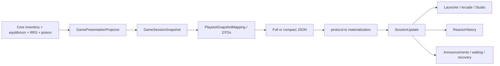

---
hide:
  - toc
---

# 5. From accepted state to the screen

[Previous: Core physics](04-core-physics.md) · [Library](index.md) · [Next: saves and lifecycle](06-saves-lifecycle.md)

**Presentation** is the transformation of accepted simulation state into
readings and visual elements. A **projection** selects or derives the information
needed by a consumer while leaving the source state under its original owner's
control. In this chapter, a **data transfer object (DTO)** is the structure used
to carry those observations across the JSON boundary.

## Observation and serialization layers

**Figure 5. Observation flow from Core to the interface.** The diagram follows
one accepted state through Game's read-only observations, Browser's wire objects
and the TypeScript controller. The three branches on the right identify consumers
of the same session update.



Reading left to right follows information, not a second simulation. The Game
projector assembles coherent readings; Browser converts them to the versioned
wire representation; `protocol.ts` reconstructs the full browser observation;
and the controller distributes it. Views display the observation, history records
measurements, and feedback components announce status or outcomes. The branches
therefore share a source rather than calculating independent reactor states.

In Mermaid, `flowchart LR` requests a left-to-right layout. Each `-->` identifies
a transfer or dependency, and the repeated `Controller` source creates the
fan-out to its consumers. Intermediate JSON transfer is shown as one stage even
though worker messaging carries it in both directions.

## Step 1: Game projects accepted numerical state

[GameSession.CreateSnapshot()](../../src/ReactorSim.Game/GameSession.cs)
assembles run/time/score/provenance fields, core observations, objective progress,
terminal status, the last movement and last daily report.
[GamePresentationProjector.Build()](../../src/ReactorSim.Game/GamePresentationProjector.cs)
constructs the detailed core:

1. Read inventory in canonical channel/position order.
2. Apply the clamped operating amplitude to the accepted normalized power shape.
3. Sum node powers into channel powers and core total.
4. Convert burnup from J/kg HM to MWd/kg HM for display.
5. Publish each bundle's identity, physical position, burnup, power, insertion
   time and state version.
6. Calculate channel mean burnup and local presentation measurements from the
   accepted flux/power, including thermal-flux-weighted axial tilt.
7. Attach channel coordinates, actual flow and authoritative refuelling
   eligibility, poison observations and device/control information.
8. Publish physical/model diagnostics: effective `k`, reactivity, power-balance
   error, solver iterations/residuals, model/cadence identity and RRS readings.

[CorePresentationContracts.cs](../../src/ReactorSim.Game/CorePresentationContracts.cs)
and [GameSessionContracts.cs](../../src/ReactorSim.Game/GameSessionContracts.cs)
define the read-only presentation objects. Geometry is projected through
[AdjusterPresentation.cs](../../src/ReactorSim.Game/AdjusterPresentation.cs) and
[LiquidZoneTubePresentation.cs](../../src/ReactorSim.Game/LiquidZoneTubePresentation.cs).
The client consumes that geometry; it does not invent a second device layout.

### Project total and channel power from accepted numerical state

These lines are from the beginning of `GamePresentationProjector.Build`. The
preceding loop gathers the accepted bundle arrays. A **power shape** specifies
the normalized spatial distribution; amplitude scales it to the operating level.

```annotated-source
path: src/ReactorSim.Game/GamePresentationProjector.cs
title: Derive observed power without advancing the simulation
language: csharp
start: double amplitude = Clamp(powerAmplitude, 0.0, 1.5);
end: 'projection.ShapeNodePowerWatts[index] * physicalShapeScale;

  }'
steps:
- through: 'double meanChannelPowerWatts = totalPowerWatts /

    GameCorePresentationConstants.ChannelCount;'
  explanation: '**Scale the accepted power shape.** Amplitude is bounded to the supported range and multiplied into total shape power. Divide by the reference watts for the operating fraction and by channel count for mean channel power. These are derived readings, not new solves.'
- through: 'projection.ShapeNodePowerWatts[index] * physicalShapeScale;

    }'
  explanation: '**Aggregate node powers by channel.** Allocate one total per channel. Integer division by twelve maps the flat node index back to its channel; `+=` sums all twelve scaled bundle powers into that channel. The result stays in watts until a view formats it.'
```

### Publish identity, burnup and power for each bundle

This is the inner bundle loop. `nodeIndex` tracks the same channel-major numerical
array used to build the channel powers; `bundle` comes from the accepted inventory.

```annotated-source
path: src/ReactorSim.Game/GamePresentationProjector.cs
title: Build one immutable bundle observation at a time
language: csharp
start: for (int bundleIndex = 0; bundleIndex < bundles.Count; bundleIndex++)
end: 'bundle.StateVersion));

  }'
steps:
- through: GameCorePresentationConstants.JoulesPerMegaWattDayPerKilogram;
  explanation: '**Convert the stored exposure unit.** Read the accepted bundle and divide J/kg heavy metal by the conversion constant to obtain MWd/kg heavy metal. This changes the display unit; it does not alter inventory burnup.'
- through: double thermalFlux = projection.SpatialSolve.Group2Flux[nodeIndex++];
  explanation: '**Read corresponding power and thermal flux.** Scale the node power by amplitude. Group 2 is the thermal neutron group. Post-increment advances the flat node cursor once per bundle, keeping fuel and numerical observations aligned.'
- through: (GameCorePresentationConstants.BundlePositionCount - 1) - 1.0);
  explanation: '**Accumulate channel summaries.** Add burnup and thermal flux. The axial coordinate maps positions 0–11 to -1 through +1, so its flux-weighted moment describes which end has more thermal flux. It is a spatial observation, not fuel-flow direction.'
- through: 'bundle.StateVersion));

    }'
  explanation: '**Freeze the bundle reading.** Construct a snapshot with physical position, stable bundle ID, material ID, converted burnup, watts, insertion time and state version. These values let views label the bundle and inspect changes while ownership of accepted state remains in the shared simulation.'
```

## Step 2: Browser maps the wire representation

[PlaytestSnapshotMapping.cs](../../src/ReactorSim.Browser/PlaytestSnapshotMapping.cs)
maps Game observations into the versioned DTOs in
[PlaytestDtos.cs](../../src/ReactorSim.Browser/PlaytestDtos.cs). This is where wire
field naming and the full/patch/core representations meet the shared snapshot.

[PlaytestDigestPolicy.cs](../../src/ReactorSim.Browser/PlaytestDigestPolicy.cs)
computes the protocol's state digests. Transport representation is part of the
contract; do not replace digest construction with a JavaScript hash of whatever
objects happen to be on screen. [ReplayDigestChain.cs](../../src/ReactorSim.Browser/ReplayDigestChain.cs)
separately tracks canonical command history.

`protocol.ts` parses/materializes the response into a `CanduSnapshot`. That
snapshot is the view's observation boundary, even when its wire source was a
compact patch. [Chapter 2](02-browser-transport.md) explains baseline recovery.

## Step 3: one session feeds multiple presentations

| Component | Responsibility |
| --- | --- |
| [AppShell](../../web/candu-playtest/src/AppShell.ts) | Own the current view and its lifetime |
| [LauncherView](../../web/candu-playtest/src/LauncherView.ts) | Choose objective/seed and enter a view |
| [ArcadeView](../../web/candu-playtest/src/ArcadeView.ts) | Pick → review → commit → result workflow for the shared one-day challenge |
| [StudioView](../../web/candu-playtest/src/studio/StudioView.ts) | Detailed selection, plan, profiles, readings and historical inspection |
| [SessionPresentation](../../web/candu-playtest/src/SessionPresentation.ts) | Retain a bounded response/impact summary across view changes |

`StudioNavigation.ts` describes the session/navigation interface used by views.
The controller survives view changes. Views own selection, expanded sections,
map mode and their DOM; the session owns the shared plan, history and journal.

### Fan one observation out to all subscribers

By this point Browser has serialized the Game snapshot and the protocol parser
has materialized a complete `CanduSnapshot`. The controller distributes it here.

```annotated-source
path: web/candu-playtest/src/sessionController.ts
title: Emit a coherent session update
language: typescript
start: 'private emit(response: CanduCommandResponse | null = null): void {'
end: 'listener(update);

  }

  }'
steps:
- through: const update = this.createUpdate(response ?? this.lastResponse);
  explanation: '**Record the observation and assemble the update.** History sees the same snapshot reference as the views. A supplied response is preferred; otherwise the most recent response provides context. History applies its own duplicate/boundary rules.'
- through: this.lastEmittedSnapshot = this.snapshotValue;
  explanation: '**Distinguish a new snapshot from a status change.** Reference equality identifies whether the snapshot object changed. Loading, pending-state or visibility updates can therefore be labelled `status` even when the reactor observation is unchanged.'
- through: 'listener(update);

    }

    }'
  explanation: '**Notify every subscriber.** The launcher, active view, announcements and other consumers receive the same update object. They render or record it; they do not each advance an independent reactor.'
```

## Step 4: Studio receives and renders

In [StudioView.ts](../../web/candu-playtest/src/studio/StudioView.ts), follow
the constructor's subscription to `receive()`, then `render()`:

1. Save the new session observation and pending/error state.
2. Handle a new response once so a repeated status emission does not repeat
   movement/outcome handling.
3. Keep channel selection and the draft consistent with the current run.
4. Update `StudioStatusView`, `DailyPlanView` and `StudioOrderView`.
5. Update `StudioMapView` and the selected channel's profiles from published data.
6. Refresh history presentation and terminal/waiting feedback as needed.

The status-only render path limits work for progress/pending changes.
[domPatch.ts](../../web/candu-playtest/src/studio/domPatch.ts) provides small DOM
patch helpers. Preserve stable focus and existing controls when changing renders;
recreating the whole view on every progress event can interrupt keyboard use.

`send()` opens `DayCalculationView` for a day command, awaits controller dispatch,
and finishes or interrupts the waiting display. Authoritative acceptance and
terminal status determine the outcome. A failed promise is not manufactured into
a day report.

## Step 5: maps and channel profiles

[StudioMapView](../../web/candu-playtest/src/studio/StudioMapView.ts) and
[ArcadeMap](../../web/candu-playtest/src/ArcadeMap.ts) render the 380 published
channels.
[powerReadings.ts](../../web/candu-playtest/src/studio/powerReadings.ts) maps
measurements and published limits into labels, bands and legends.

Power, burnup and ripple are different map quantities. Formatting a threshold
band is view policy; deciding that a run has exceeded its allowed power is Game
policy. The inspector's outgoing-burnup estimate averages the published outgoing
positions. It does not execute hypothetical inventory moves or solve future
physics.

[displayScales.ts](../../web/candu-playtest/src/studio/displayScales.ts) and
[displaySamples.ts](../../web/candu-playtest/src/studio/displaySamples.ts)
support readable plotted bounds and sampling. [devicePresentation.ts](../../web/candu-playtest/src/studio/devicePresentation.ts)
formats shared device geometry for the map and profiles. The map's visible channel
name is not an array index; coordinate helpers use the published channel records.

## Step 6: history is observation storage

[ReactorHistory](../../web/candu-playtest/src/studio/ReactorHistory.ts) accepts
only authoritative WASM observations. It derives chart samples from published
powers, burnup, control, poison, stock and score. It never advances simulation.

The current limits are 4,096 measurement points and 128 retained inspectable
snapshots. Not every plotted point retains an entire 4,560-bundle observation.
Unchanged measurements/status emissions are deduplicated. Reset or backward
time/operation transitions clear the prior series.

[HistoryView](../../web/candu-playtest/src/studio/HistoryView.ts) handles traces,
time windows, cursor/sample inspection and selection of retained snapshots.
Historical inspection changes what is displayed; it does not rewind the live
`GameSession`. Studio blocks operations while inspecting history until the player
returns to live.

Null measurements mean unavailable: for example, there is no confirmed discharge
burnup before a discharge, and unlimited stock has no finite history quantity.
Replacing null with zero would tell the player a different story.

## Step 7: accessibility and lifetime

[SessionAnnouncements](../../web/candu-playtest/src/SessionAnnouncements.ts)
publishes quiet session changes to the live region.
[SimulatorManual](../../web/candu-playtest/src/SimulatorManual.ts) supplies the
workflow, map and keyboard guide. Its chapter content comes from the same
[Markdown sources](manual/index.md) published by MkDocs, imported and rendered
by [manualContent.ts](../../web/candu-playtest/src/manualContent.ts).
[DayCalculationView](../../web/candu-playtest/src/studio/DayCalculationView.ts)
handles pending and final day feedback, including reduced motion.

Each view removes subscriptions and event listeners in `destroy()`. `AppShell`
destroys the old view before mounting its replacement. Keyboard targets, manual
focus restoration, reduced-motion behavior and 320px layouts are presentation
requirements covered by component tests and browser smoke checks.
