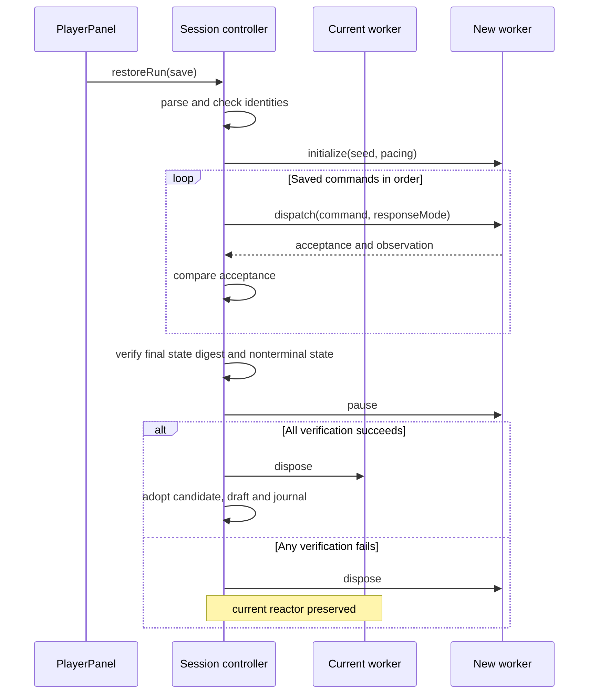

# 6. Saves, restore and application lifecycle

[Previous: presentation](05-presentation.md) · [Library](index.md) · [Next: development](07-development.md)

A **replay save** records the initial conditions and sequence of commands needed
to reconstruct a run. Its reliability depends on deterministic simulation and
compatible model versions. A **state digest** is a compact identity calculated
from the protocol's defined state representation; comparing it after replay
checks whether reconstruction produced the expected result.

## Saves store replayable inputs

[runSave.ts](../../web/candu-playtest/src/runSave.ts) defines `RunSave`,
`RunJournal` and `parseRunSave()`. A saved run includes its seed and objective,
pack/scoring identities, command log, final state digest, summary measurements,
and version-2 pacing/draft/integration information.

The displayed `CanduSnapshot` is not serialized and later assigned into Core.
Restore reconstructs the run by replaying commands through a fresh authoritative
runtime. This keeps state creation behind the same validated operations as play.

## Step 1: journal exact bridge inputs

After a successful transport response, the controller calls
`RunJournal.record(command, response, responseMode)`. The journal retains a clone
of the command, whether Game accepted it, and the response representation. An
authoritatively rejected command can therefore appear in a replay log. A transport
exception with no response cannot be treated as a verified replay outcome.

An accepted reset clears the earlier log and records an explicit seed/objective
from its resulting snapshot. That makes an originally implicit “retry” reproducible
in a newly initialized worker. Geometry modifications make the journal unsaveable
for the supported standard-run path. Limits on commands and bytes bound saved
input size.

`capture()` requires a verified digest and unmodified run, includes the unfinished
daily plan, then validates the assembled save with `parseRunSave()`.
`startShift()`'s initial no-time pause makes a brand-new frozen decision saveable.

## Step 2: validate compatibility before restore

[BridgeSessionController.restoreRun()](../../web/candu-playtest/src/sessionController.ts)
parses the file and checks:

- Required pacing; version 1 is interpreted as real-time and cannot resume in
  the public daily client.
- The run is not ended.
- Pack and score-policy identities match the currently loaded application.
- A version-2 daily save's integration identity matches the loaded cadence.
- No command/restore is already pending.

Parsing also validates supported command shapes, bounds, metadata and draft
structure. An old save remaining in storage does not mean the current public
runtime accepts it.

## Step 3: replay in an isolated candidate worker

**Figure 6. Restore with verification before adoption.** The current worker
retains the live reactor while a new worker reconstructs the saved run. Reading
downward follows the restore sequence. The `loop` region represents one dispatch
per saved command, and the `alt` region separates successful adoption from failure
cleanup.

The two workers serve different roles: `Live` remains the current accepted
session, whereas `Candidate` is provisional. Replaying a command in the candidate
does not issue that command to the live reactor. Only the successful branch
disposes the old worker and makes the candidate the current session; the failed
branch disposes the candidate instead. The figure summarizes validation and
exception handling rather than showing every early return in the implementation.

The Mermaid `participant` statements declare the columns. `loop`/`end` encloses
repetition, `alt`/`else`/`end` expresses alternative paths, and `Note over` adds an
explanatory annotation. The opening width directive affects the figure's layout,
not the number of workers or the restore algorithm.

The controller reports replay progress, compares each command's acceptance with
the saved value, and verifies the final digest. It then pauses the restored run
and checks the draft's channel eligibility. Only after these checks does it
unsubscribe/dispose the old bridge and adopt the candidate.

History and transient presentation are cleared on success; the saved draft and
journal are adopted. A `finally` block disposes an unadopted candidate and clears
restore/pending status after either outcome. Full chart history is not reconstructed
as a persisted artifact of restore.

## Step 4: store and optionally synchronize

[PlayerPanel.ts](../../web/candu-playtest/src/PlayerPanel.ts) orchestrates account,
save/load and update-save UI.
[PlayerStore](../../web/candu-playtest/src/playerStore.ts) uses IndexedDB so large
command logs do not block rendering through synchronous browser storage. Stored
records include owner/run identity.

[cloudPlayer.ts](../../web/candu-playtest/src/cloudPlayer.ts) provides the optional
cloud/account adapter. The database schema and ownership/revision rules live in
the repository's `supabase` migrations. Those services store and synchronize saves
and related player data; the local WASM worker remains the simulation authority.
Guest/offline play remains available. See the existing
[accounts and saves guide](../maintenance/player-accounts.md) for configuration
and migration requirements, including version-2 daily saves.

`cloudOwnerId` and `cloudRevision` carry synchronization identity. They should
not be discarded during local edits or treated as permission to overwrite another
owner's save. `RunJournal.markSynced()` updates synchronization metadata only
for the matching run.

## Step 5: identify and apply complete game updates

[GameUpdateView.ts](../../web/candu-playtest/src/GameUpdateView.ts) and the service
worker generated by [offlinePlugin.ts](../../web/candu-playtest/offlinePlugin.ts)
manage update discovery/application. The loaded WASM build is identified by generated
build metadata. The user can save locally before applying a waiting update;
a failed save prevents reload. Other game tabs must close before replacing the
old worker and loading the current complete build.

This matters because the JavaScript protocol, managed exports, pack identities
and integration model must agree. Loading a newer UI with an older runtime is
not a safe partial update. Startup's daily-cadence checks and recovery view
make incompatibility visible.

The update flow and old-tab behavior are detailed in
[hosting and verification](../maintenance/hosting.md). The game's Pages artifact
is produced by its deployment workflow; the documentation generator uses a
separate output directory.

## Step 6: release resources

`main.ts` forwards visibility changes to the controller and cleans up on unload.
The controller disposes subscriptions, the scheduler and bridge; the bridge
clears deadlines and terminates its worker. Views release their own DOM listeners
and subscriptions. A failed restore also releases its additional worker.

Retained real-time scheduling code is shared support for comparison paths.
`isPlaybackActive()` explicitly disables it for the required daily client and
daily snapshots. Hiding/reopening the page never silently advances a daily run.
