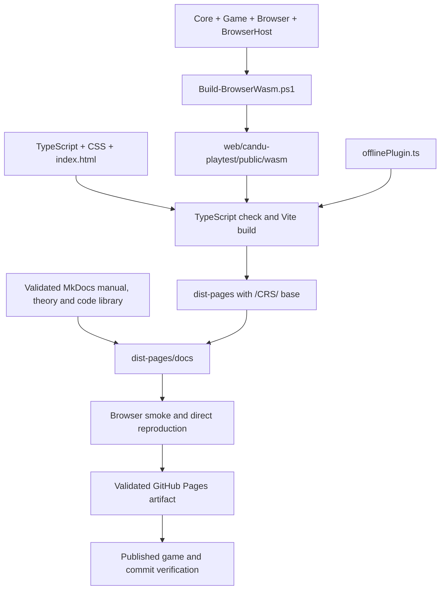

# 7. Build, tests and debugging

[Previous: saves](06-saves-lifecycle.md) · [Library](index.md) · [Next: source atlas](08-source-atlas.md)

A **build** converts source files into executable and presentation assets.
**Staging** places generated assets where a later build can include them, while
**deployment** publishes a validated set of assets to the hosting service. CRS
builds the managed simulation and the browser interface separately, then combines
their outputs into one playable distribution.

## How the deployed game is assembled

**Figure 7. Build and verification pipeline.** The diagram shows how the managed
projects and frontend sources converge into the Pages artifact. A build artifact
is the generated collection of files passed to the next stage.



The upper branch compiles and stages the C# runtime, and the TypeScript branch
checks and bundles the interface. Vite includes the staged runtime and generated
offline support in `dist-pages`. Browser checks then exercise those combined
files before the deployment workflow publishes them. The arrows represent
build dependencies and artifact handoffs rather than runtime calls made by the
player's browser. `flowchart TD` selects a top-to-bottom figure, and the two
arrows into the Vite node show where the independently prepared inputs combine.

[Build-BrowserWasm.ps1](../../tools/Build-BrowserWasm.ps1) publishes the .NET 10
`browser-wasm` executable, collects its host/framework assets, stages a clean
generated runtime in `public/wasm` and writes build identity. Threads and CPU
parallelism are disabled for this runtime. Release CI enables AOT compilation.
The source `public/wasm/.gitkeep` is tracked; generated runtime binaries are not.

[vite.config.ts](../../web/candu-playtest/vite.config.ts) configures the frontend
and offline plugin. [package.json](../../web/candu-playtest/package.json) exposes
the TypeScript check/build, test and smoke commands. `build:pages` sets `/CRS/`
as the base URL and writes `dist-pages`. The generated service worker is build
output from [offlinePlugin.ts](../../web/candu-playtest/offlinePlugin.ts).

## Running locally

Local development requires .NET 10 with its WebAssembly workload and a Node
version accepted by the frontend's `engines` field (at least 22.12.0). CI currently
uses Node 24.

**Example 3. Preparing the runtime and starting the development server.** These
PowerShell commands are run sequentially, beginning at the repository root:

```powershell
powershell -ExecutionPolicy Bypass -File tools/Build-BrowserWasm.ps1
Set-Location web/candu-playtest
npm ci
npm run dev
```

| Command | Operation and result |
| --- | --- |
| `powershell ... -File tools/Build-BrowserWasm.ps1` | Runs the repository's WASM build/staging script; `-File` identifies the script and `-ExecutionPolicy Bypass` selects the execution policy for that PowerShell process |
| `Set-Location web/candu-playtest` | Changes the working directory so later npm commands use the browser package |
| `npm ci` | Installs the dependencies recorded by the package lockfile, replacing an existing dependency installation if present |
| `npm run dev` | Runs the package's Vite development-server script and leaves the server running for browser access |

The first command produces the simulation assets consumed by the final command.
The development server prints its local URL; opening that URL loads the interface
and worker path described in [startup](01-startup.md). Building TypeScript alone
does not compile a changed C# simulation, so shared/runtime changes require
another WASM staging pass.

## Which tests protect each connection

| Boundary | Focused examples | What they establish |
| --- | --- | --- |
| Topology/inventory | [TopologyInventoryRefuellingTests](../../tests/ReactorSim.Core.Tests/TopologyInventoryRefuellingTests.cs), [AgedCoreSnapshotTests](../../tests/ReactorSim.Core.Tests/AgedCoreSnapshotTests.cs) | Identities, movement, indexing and seeded starts |
| Numerical solve | [SpatialSolveTests](../../tests/ReactorSim.Core.Tests/SpatialSolveTests.cs), [EquilibriumCoreSolverTests](../../tests/ReactorSim.Core.Tests/EquilibriumCoreSolverTests.cs), [AxialVacuumBoundaryTests](../../tests/ReactorSim.Core.Tests/AxialVacuumBoundaryTests.cs) | Convergence, projection and boundary behavior |
| Poison/control | [PracticeXenonTests](../../tests/ReactorSim.Core.Tests/PracticeXenonTests.cs), [PracticeLiquidZoneRrsTests](../../tests/ReactorSim.Core.Tests/PracticeLiquidZoneRrsTests.cs), [PracticeLiquidZoneTubeTests](../../tests/ReactorSim.Core.Tests/PracticeLiquidZoneTubeTests.cs) | Evolution, zone response and geometry |
| Daily transaction | [DailyTurnTests](../../tests/ReactorSim.Game.Tests/DailyTurnTests.cs) | Plan validation, single-step exposure, atomic rejection and committed outcomes |
| Game policy | [PracticeScoringTests](../../tests/ReactorSim.Game.Tests/PracticeScoringTests.cs), [PracticeOperatingLimitsTests](../../tests/ReactorSim.Game.Tests/PracticeOperatingLimitsTests.cs), [ShiftProgressTests](../../tests/ReactorSim.Game.Tests/ShiftProgressTests.cs) | Score, limits and objectives |
| Wire/runtime | [DailyTurnBridgeTests](../../tests/ReactorSim.Browser.Tests/DailyTurnBridgeTests.cs), [PlaytestBridgeTests](../../tests/ReactorSim.Browser.Tests/PlaytestBridgeTests.cs), [ReplayBookkeepingTests](../../tests/ReactorSim.Browser.Tests/ReplayBookkeepingTests.cs) | JSON operations, full/compact responses and digests |
| Browser state | [bridge.test.ts](../../web/candu-playtest/src/bridge.test.ts), [sessionController.test.ts](../../web/candu-playtest/src/sessionController.test.ts), [dailyTurns.test.ts](../../web/candu-playtest/src/dailyTurns.test.ts) | Queue/failure handling, daily enforcement and controller transitions |
| Presentation/saves | [StudioView.test.ts](../../web/candu-playtest/src/studio/StudioView.test.ts), [ArcadeView.test.ts](../../web/candu-playtest/src/ArcadeView.test.ts), [runSave.test.ts](../../web/candu-playtest/src/runSave.test.ts), [ReactorHistory.test.ts](../../web/candu-playtest/src/studio/ReactorHistory.test.ts) | Input, view lifecycle, replay validation and history |
| Actual built browser | [scripts](../../web/candu-playtest/scripts) smoke/reproduction programs | Real WASM, asset subpaths, daily loop, layout, save/update behavior and build identity |

**Example 4. Running the repository's automated checks.** Both commands below
start at the repository root. `Release` selects the optimized .NET configuration
used by CI; it does not change the test assertions:

```powershell
powershell -ExecutionPolicy Bypass -File tools/Test-DotNet.ps1 -Configuration Release
powershell -ExecutionPolicy Bypass -File tools/Test-Browser.ps1 -Configuration Release
```

The first command runs `Test-DotNet.ps1`, which selects the Core, Game and Browser
.NET suites by default; its optional `-Suite` parameter narrows that selection.
The second runs `Test-Browser.ps1`, which executes the Browser .NET suite, Vitest
and a production frontend build. The Browser suite therefore appears in both
wrappers when the complete pair is used. Passing checks finish without a failing
exit code; a failing stage identifies which boundary requires investigation.

These checks verify shared logic, wire contracts and frontend behavior. They do
not automatically publish managed WASM or replace a smoke test against the real
built browser host. A **smoke test** exercises representative application paths to
detect failures in the assembled system, such as missing runtime assets.

## Verify the Pages subpath

**Example 5. Serving a production-shaped build under `/CRS/`.** After WASM staging,
these commands run from `web/candu-playtest`. The subpath reproduces the URL
structure used by GitHub Pages:

```powershell
npm run build:pages
npm run preview -- --configLoader runner --outDir dist-pages --base /CRS/ --host 127.0.0.1 --port 4175
```

`npm run build:pages` checks and bundles the frontend into `dist-pages`, using
`/CRS/` as its asset base. `npm run preview` then serves that directory. The first
`--` forwards the remaining arguments to the script. `--configLoader runner`
selects Vite's configuration-loading mode, `--outDir` identifies the built files,
and `--base` sets the URL prefix. `--host 127.0.0.1` binds the server to the local
machine, and `--port 4175` selects the listening port. A successful startup makes
the game available at `http://127.0.0.1:4175/CRS/` and keeps the terminal occupied
until the server stops.

**Example 6. Exercising the served build.** With that preview server still
running, the following commands execute in a second terminal whose working
directory is also `web/candu-playtest`:

```powershell
npm run smoke -- http://127.0.0.1:4175/CRS/
npm run smoke:arcade -- http://127.0.0.1:4175/CRS/
npm run smoke:scales -- http://127.0.0.1:4175/CRS/
npm run smoke:accessibility -- http://127.0.0.1:4175/CRS/
npm run smoke:saves -- http://127.0.0.1:4175/CRS/
node scripts/benchmark-wasm.mjs http://127.0.0.1:4175/CRS/ --bridge=direct --label=pages-local --warm-samples=1
```

| Command | Part of the assembled application it exercises |
| --- | --- |
| `npm run smoke` | The shared daily-turn acceptance path, including actual WASM availability |
| `npm run smoke:arcade` | Arcade's selection, review and challenge presentation |
| `npm run smoke:scales` | Map/chart display scales and related presentation behavior |
| `npm run smoke:accessibility` | Keyboard, focus and supported responsive/accessibility paths |
| `npm run smoke:saves` | Saved-run behavior through the browser interface |
| `node scripts/benchmark-wasm.mjs ...` | Direct bridge reproduction and timing in the browser-host environment |

Each smoke command receives the preview URL after npm's argument separator.
The final command invokes a Node script directly: `--bridge=direct` chooses its
direct-export path, `--label=pages-local` names the measurement run, and
`--warm-samples=1` requests one warm sample. The expected evidence is a successful
script result and its diagnostic or measurement output. Timing values are
observations of the machine running the benchmark, not fixed acceptance promises.

Update testing builds and compares two versions; use the separate
`npm run smoke:upgrade` path described in [hosting](../maintenance/hosting.md).
Direct solver reproduction and a worker-based gameplay smoke exercise different
connections, so a direct numerical match alone does not establish UI acceptance.

## The production workflow

[deploy-candu-playtest.yml](../../.github/workflows/deploy-candu-playtest.yml)
validates shared code, publishes Release AOT WASM, verifies staged build metadata,
and runs browser tests/build. The Pages build downloads that validated runtime,
builds under `/CRS/`, and includes the validated MkDocs output under `/CRS/docs/`.
It then exercises daily, Arcade, display-scale, accessibility, save, documentation,
upgrade and direct reproduction checks before uploading its artifact.
Main-branch publishing is followed by deployed commit and gameplay checks.
Pull requests validate without publishing.

Documentation preview has its own local output directory. Its production output
is included in the game's Pages artifact, so one validated release publishes both
the playable client and its manual, theory and code library. The in-game manual
bundles the same Markdown chapters used by MkDocs.

## Debug by following the boundary that failed

| Symptom | First places to inspect | Evidence to collect |
| --- | --- | --- |
| Loading never becomes ready | `wasmWorker.loadWasm()`, host `main.mjs`, factory startup | Worker error, requested `/CRS/wasm/` assets, factory diagnostic |
| UI says update required | Lifecycle bridge cadence check, controller `checkedStatus()` | Loaded pacing/cadence, UI build and `wasm/build-info.json` |
| Day rejected before work | `ValidateDailyPlan()`, Browser parsing | Diagnostic code, day count, unique indices, eligibility and stock |
| Day ended with fuel left unexecuted | `BeginDay()` loop and `DailyTurnResult` | Last movement, operating end reason, executed/unexecuted lists |
| Power or zone readings unexpected | Accepted projection, `TryBuildRrsEquilibrium()`, pack/burnup/poison bindings | Pack ID, seed, command log, flux/power units, RRS decision/residuals |
| Compact mismatch | `resolveDispatchOptions()`, `Dispatch()`, protocol materializer | Requested baseline, authoritative sequence, resync response |
| Slow day but responsive page | Worker transport metrics and solver profiling | WASM time versus payload/materialization versus rendering |
| Graph wrong but snapshot correct | `ReactorHistory`, display scales/samples and `HistoryView` | Units, null handling, sample deduplication and live/history selection |
| Save cannot restore | `parseRunSave()`, isolated replay, digest check | Pack/scoring/integration IDs and first acceptance mismatch |
| One view updates twice/leaks | `subscribe()`/`destroy()` and shell transitions | Number of subscriptions/listeners and repeated response identity |

Optional runtime profiling is enabled through `Build-BrowserWasm.ps1
-EnableRuntimeProfiling`; the exported profiling operation exists only in that
build. Keep normal solver fidelity when measuring. The existing
[runtime-profile notes](../physics/runtime-profile.md) and
[research-tool index](../maintenance/research-tools.md) explain comparison tools.

When investigating a physics result, retain seed, objective, pack identity and the
ordered command log. A screenshot alone cannot reproduce the deterministic state.
