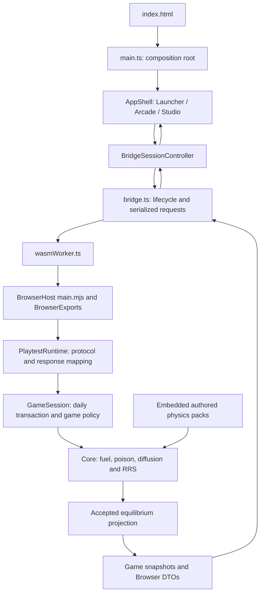

# CRS documentation

This site brings together the player manual, reactor theory and code documentation
for the [CRS browser game](https://hkkho.github.io/CRS/).

| Library | Purpose |
| --- | --- |
| [Player manual](manual/index.md) | Learn the daily workflow, controls, maps, limits, scoring and saves |
| [Reactor theory](theory/index.md) | Understand neutron balance, fuel exposure, poison, regulation and the numerical approximation |
| [Code walkthrough](01-startup.md) | Trace startup, commands, transactions, physics and observations through the implementation |

## Code documentation library

CRS is a browser-based CANDU refuelling game whose reactor state is calculated by
a shared C# simulation. This library describes the software's execution, data
structures and component relationships, from the first browser script to the
numerical calculation and the resulting display. Each chapter identifies the
relevant source files, inputs, operations and outputs. It describes the working tree
reviewed on **23 October 2026**, including daily turns, Arcade and Studio, and the
v8 axial physics pack. Source links intentionally target files rather than fragile
line numbers.

## Reading order

| Chapter | Subject |
| --- | --- |
| [1. Entry points and startup](01-startup.md) | How HTML starts TypeScript, how the worker loads .NET, and how a seeded core becomes ready |
| [2. Browser commands and transport](02-browser-transport.md) | Controller responsibilities, both queues, protocol validation, compact snapshots and recovery |
| [3. One complete daily turn](03-daily-turn.md) | Plan validation, detached candidates, each fuel movement, exposure, adoption and failure outcomes |
| [4. Core state and physics](04-core-physics.md) | Topology, inventory, burnup, poison, two-group diffusion, equilibrium and liquid-zone control |
| [5. Snapshots and presentation](05-presentation.md) | How shared state becomes DTOs, maps, channel profiles, history and accessible feedback |
| [6. Saves and lifecycle](06-saves-lifecycle.md) | Command replay, isolated restore, local storage, optional cloud storage and safe updates |
| [7. Build, tests and debugging](07-development.md) | How source becomes the Pages game, which tests protect which boundaries, and where to debug |
| [8. Source atlas and glossary](08-source-atlas.md) | A responsibility index and terminology for navigating the wider codebase |
| [9. Maintaining and viewing this library](09-documentation-tools.md) | Markdown, MkDocs, Mermaid, Doxygen tradeoffs and documentation checks |

For a shorter first pass, read chapters 1, 3 and 5. For a numerical change, read
chapter 4 and the existing [active solver equations](../physics/active-two-group-solver.md).
The [implementation guide](../IMPLEMENTATION_GUIDE.md) remains the product contract;
this library explains its implementation.

## The whole connection

**Figure 1. Application layers and the return of observations.** The diagram
summarizes the request path and the data returned to the interface. Each box is
a component or group of components; arrows indicate a principal dependency or
transfer of information. This is an architectural overview rather than a complete
function-call graph.

Reading downward follows a player action from the interface into the shared
simulation. `main.ts` is the **composition root**, the place where the application's
long-lived objects are constructed and connected. The controller turns interface
actions into requests, while the worker carries those requests to the managed
runtime. `GameSession` applies game policy, and Core calculates inventory and
physics using the embedded packs.

The return arrows represent **snapshots**, read-only descriptions of the accepted
reactor state. Views format these observations rather than calculating an
independent reactor. Here, **authoritative** means that the shared simulation is
the component allowed to determine state and outcomes. If WebAssembly (WASM), the
browser execution format used by the C# host, is unavailable, the client cannot
substitute its own simulation.

## Interpreting examples and diagrams

The library uses three kinds of fenced block. JSON and shell examples show data
or commands in their actual syntax. Blocks labelled `text` express mathematical
relationships using code-like names; they are explanatory notation rather than
complete executable programs. Mermaid blocks describe diagrams that a compatible
viewer converts into figures.

Each block is introduced by its purpose and followed by an explanation of its
fields, symbols, operations or paths. Numerical examples illustrate the stated
relationship; they are not recorded benchmark results. Source links and the
existing specifications provide the implementation evidence for the explanation.

## Principal distinctions

- **Draft versus command:** adding a channel to a plan changes browser state;
  committing the day requests an authoritative transaction.
- **Shape versus amplitude:** the spatial solver normalizes a power shape to a
  reference thermal output; presentation applies the operating amplitude.
- **Rejected versus lost:** a rejected calculation preserves the reactor; an
  accepted physical loss records the observed outcome and ends play.
- **Snapshot versus state:** a snapshot is a read-only observation, not the bundle
  inventory or a save file that can simply be assigned back to the solver.
- **Daily versus comparison cadence:** the public application uses one large
  daily interval. Retained real-time contracts support direct comparison tools.
- **Authored versus validated plant data:** the embedded packs are gameplay
  approximations. Shutdown, scram, accidents, operator training and full plant
  operation are outside this product.

## Using the library

Open these Markdown files directly in a viewer with Mermaid support, or follow
the [MkDocs preview instructions](09-documentation-tools.md). All prose and diagrams
are version controlled. The documentation build writes to `artifacts/code-library`
for local review. The Pages workflow also places it in the game's `docs/`
subdirectory, published at [CRS Documentation](https://hkkho.github.io/CRS/docs/).

Start tracing at [web/candu-playtest/index.html](../../web/candu-playtest/index.html)
and continue to [chapter 1](01-startup.md).
