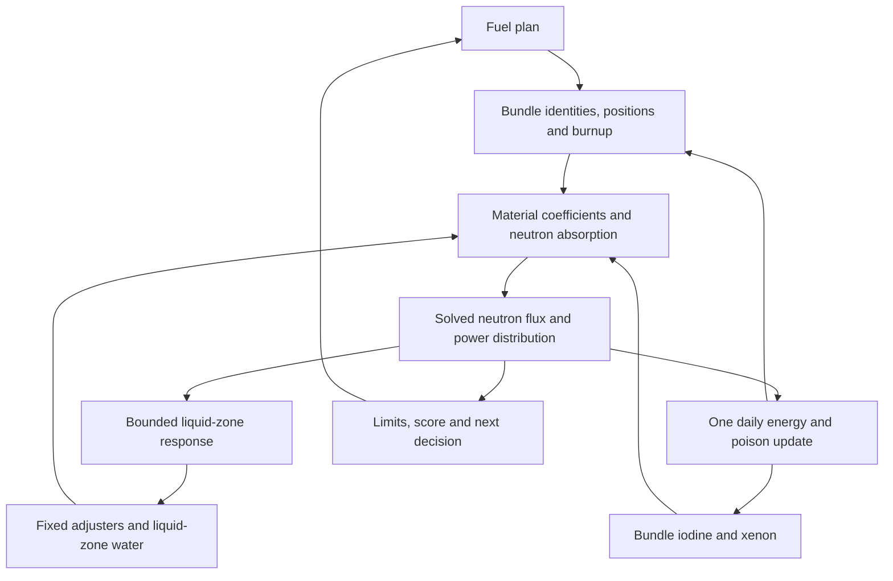

# Reactor theory

The CRS reactor model connects fuel movement to neutron balance, spatial power,
fuel exposure and later refuelling decisions. This section explains that chain of
cause and effect in the current daily-turn game. The [player manual](../manual/index.md)
describes how to operate the interface, while the [code walkthrough](../04-core-physics.md)
identifies the classes that implement the calculations.

## Reading order

| Chapter | Central question |
| --- | --- |
| [Neutrons and power](neutrons.md) | How do fission, flux, multiplication and power relate? |
| [Fuel and burnup](fuel.md) | How do bundle history and eight-bundle movements change the core? |
| [Poison and regulation](regulation.md) | How do iodine, xenon, adjusters and liquid zones affect neutron absorption? |
| [Numerical model](numerical-model.md) | How are those inputs combined into the next daily observation? |

## The model's feedback loop

**Figure 1. Cause and effect across daily decisions.** The boxes describe physical
or game-model quantities. Arrows indicate how one stage changes the inputs used
by a later stage; they do not represent a continuously running real-time model.

Refuelling changes material and poison at particular spatial locations. The solver
calculates their effect on neutron distribution, and the controller evaluates
liquid-zone adjustments. If play can continue, that post-refuelling state supplies
the power and flux used for one daily exposure interval. Updated fuel and poison
then determine the next boundary solution. The small control loop and the daily
exposure loop therefore describe different calculation stages. In the Mermaid
source, `flowchart TD` selects a vertical layout and arrows express dependencies.

## Current implementation and historical studies

The current game uses the v8 axial Marshak boundary and authored compact physics
packs. It calculates a large daily exposure step and equilibrium observations,
rather than resolving every intraday transient. Pack parameters are calibrated
for plausible gameplay; they are not validated operating data for a named plant.
Shutdown, scram, accidents, operator training and full plant operations are outside
the product's scope.

The repository retains a [historical student guide](../../physics/candu-nuclear-diffusion-student-guide.md)
and [calibration library](../../maintenance/knowledge-library.md). Their older
phase plans and pack results must be read in their dated context. These MkDocs
chapters describe the active game; the [active solver specification](../../physics/active-two-group-solver.md)
provides the detailed numerical equations and current coefficient tables.

[Return to the game](https://hkkho.github.io/CRS/).
