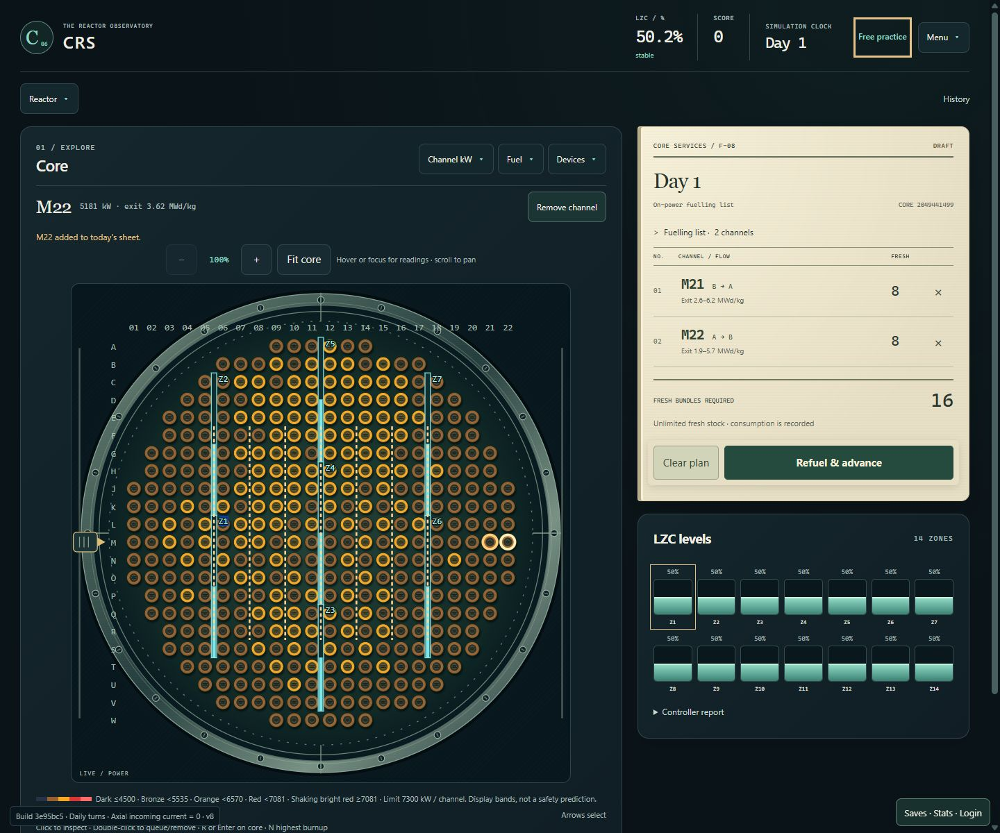
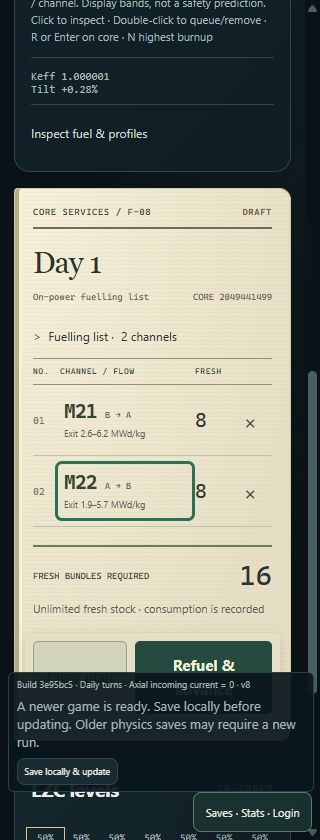

# Interface simplification plan

Implemented in the working tree on `design/reactor-observatory`, 24 October 2026.
The audit and plan below now describe the simplified interface. It follows the browser-game-studio principle that
intent, commitment and consequence should form one readable loop.

## Delivered and verified

- Removed the workbench card. A compact selected-channel line sits above the
  map, where its optional Add/Remove action remains reachable on touch screens.
  One expandable inspection area below the map retains the unique readings,
  OUT/KEEP movement preview and all axial profiles.
- The paper sheet heads the side column, followed by the existing fourteen zone
  readings. Rows now link back to the corresponding channel. Fuel stock and
  draft demand appear together on the sheet, without another header stock total.
- Compact goal progress replaces the banner and Menu's duplicate mission card.
  A single New run disclosure supplies seed/objective setup. History controls
  expand on demand and remain visibly labeled during recorded-day inspection.
- One day record retains every movement and its identities. Terminal days go
  straight to the final run report. Ordinary days keep the compact score result.
- Arcade retains the same paper/list nodes through review, with locked rows and
  a single action region. The launcher uses goal selection and one Start action,
  with presentation, optional guidance and seed options in the same setup.
- Existing map zoom, value bands, simulation ownership, save/journal format,
  goals and operating limits are preserved. No new simulation or cloud migration.

The selected-channel line is above rather than below the map in the initial
layout proposal, to keep the touch action reachable. Its short status message
reserves space so selecting/queuing cannot shift the map between double-clicks.
Sheet row links override the old 44px removal-button width; × remains 44px.

| Verification | Result |
| --- | --- |
| Frontend/database | 204 tests in 35 files passed, including direct drafting, locks, row inspection/removal/focus and stable Arcade review nodes. |
| Production packaging | TypeScript and the `/CRS/` production build passed. Uses the unchanged AOT shared runtime stamped `3e95bc5`. |
| Daily browser loop | Multi-channel day, empty day, frozen planning, physical loss directly to report, recovery and narrow layout passed without browser errors. |
| Arcade | Touch selection/zoom, power/burnup, one-sheet review, real day, actual missed-goal result and retry passed at 320/390/768/1280px. |
| Accessibility | Keyboard-only complete loop, manual focus trap/return, no duplicate accepted-order announcements, reduced motion, 200% zoom equivalent and 320/640/1280px passed. Desktop core 718px; expanded axial graph 360.86px. |
| Saves | Guest/local save, offline reload and authoritative WASM replay restored day, score, fuel and draft; 320px dialog passed. |
| Readings/charts | Published color bands, outgoing-burnup tooltip, all twelve axial readings, off-scale limits and narrow charts passed. |
| Final direct-input smoke | Consecutive adjacent-channel double-clicks, remove/re-add and sheet-row inspection passed against the real browser/WASM session before a multi-channel day and an empty day. |

The final phone form measured 277px wide with 275px of internal content at a
320px viewport; removal targets measured 44×44px. Browser captures below are
actual rendered interfaces with an unexecuted two-channel plan.





Local preview: `http://127.0.0.1:4183/CRS/`. To restart it from
`web/candu-playtest`, use `npm run build:pages`, then
`npm run preview -- --host 127.0.0.1 --port 4183 --outDir dist-pages --base /CRS/`.

Logs and automated captures are under ignored
`artifacts/interface-simplification/`. These are internal acceptance checks;
human usability testing and physical phone/Safari/Firefox evaluation remain
outstanding. The site has not been published. Pre-existing workspace work was
preserved and remains alongside this implementation.

`tools/Test-Browser.ps1 -Configuration Release` completed successfully: 45
shared Browser tests (6m54s), 204 frontend/database tests and the production build.
The NuGet vulnerability feed was unavailable during restore; installed packages
built and the suites completed.

## Direction

Give each task a clear home: inspect and target on the reactor, edit today's
orders on the paper sheet, and read confirmed outcomes in the day record.
Remove panels and repeated prose before adding replacements. Preserve the
physical materials and use empty space to give the reactor and sheet prominence.

The repeated action stays: inspect a channel, toggle its eight-bundle order,
review the sheet, advance one day, and inspect the changed core. Only the shared
simulation determines costs, operating outcomes, progress and rewards.

## Channel interaction

| Input | Proposed result |
| --- | --- |
| Click a core channel | Inspect it immediately; update the locator, readings and profiles. Do not change the draft. |
| Double-click a core channel | Add it to the draft; double-click it again to remove it. Toggle once per double-click. Never advance time. |
| Click a sheet row | Inspect that channel on the core. Preserve map mode and zoom. |
| Click a row's × | Remove that order. Keep focus in the list or move to its empty-state control when no rows remain. |
| Arrow keys on the core | Move inspection using existing spatial navigation. |
| R on the core | Toggle the inspected channel using the existing shortcut. |
| Enter/Space on a focused channel | Toggle that channel, with one activation and an accessible queued-state announcement. |
| Touch | Tap to inspect; use one compact Add/Remove control beside the selected-channel readout. Double-tap is not required. Retain scrolling/zooming. |

Keep inspection and queued status visually distinct: the locator/focus outline
means inspected; the existing planned marking means on today's sheet. The
interaction hint should say "Click to inspect · double-click to queue/remove"
for a pointer, with the corresponding keyboard/touch wording for those inputs.

Two single-click handlers during a double-click may inspect twice, but cannot
toggle the draft. The double-click handler owns the pointer toggle. A drag/pan
must never queue a channel. Ineligible, pending, historical and terminal states
retain existing locks and explain a blocked attempt beside the selection.
Adding/removing is reversible; advancing the day remains an explicit sheet action.

## Duplicate audit

| Current surfaces | Decision | Remaining home / preserved distinction |
| --- | --- | --- |
| Channel workbench Add/Remove, sheet removal, map selection | Remove the workbench card and its large action button. | Direct map interaction plus × on the sheet. A compact touch action stays at the map selection readout. |
| Workbench readings, long map tooltip, separate axial profiles | Consolidate inspection into one expandable area directly below the core. | A small selected-channel line gives coordinate, current power and exit burnup. Expand for local tilt, ripple/reference, peak bundle, OUT/KEEP strip and axial plots. Hover/focus offers a short preview; selecting gives persistent details. |
| Header fuel stock, goal banner fuel remaining, sheet stock | Remove stock from header and goal banner. | Sheet footer shows draft demand and run stock together. Keep spent fuel in the historical report because it answers a different question. |
| Sheet summary "2 channels · 16 bundles" plus large "16 required" | Count channels once; show bundle demand once. | Sheet title carries day and channel count; footer carries required / available bundles. Each row still shows its own eight-bundle cost. |
| Full run-goal banner and Menu mission details | Replace banner with a compact goal/progress line in the header. | Title, completed days and useful-discharge progress where required; expanded description/reward in one goal disclosure. Free practice needs only its name, without an empty progress display. |
| Menu One-day challenge toggle, objective selector/start, New shift | Consolidate run creation. | One New run action opens the existing seed/objective choices. Same-seed retry and new-core retry remain on terminal results, where they are useful. |
| Reactor view toolbar's always-visible time slider, LIVE tag, disabled Following live | Show history navigation only when useful. | Latest core view keeps a History entry. Open history to scrub; while inspecting an older sample, show a prominent recorded-day label and Return to current day. Existing edit locks remain. |
| Last fuel move card and sheet Day report, both with bundle identities/movement | Remove the separate Last fuel move card. | One day record with summary and expandable movement rows. Preserve last-operation impact text with its specific operation; do not relabel it as the whole day's response. |
| Calculation modal, daily survival result, day report, terminal shift report | Keep one outcome presentation per stage. | Running feedback transitions to the actual result. A normal day has a compact day receipt; a terminal day shows the final run report directly. Keep complete day/movement records accessible from the receipt. Rejection, numerical failure, physical loss and unknown transport outcome stay distinct. |
| Arcade paper list, separate review list, footer repeated totals | Reuse the paper list as its review surface. | Review changes the sheet's state and focuses its final action rather than rebuilding another list. Back to editing remains. One sheet action region becomes sticky on narrow screens. |
| Launcher goal cards and objective dropdown/Apply/Begin actions | Use one run setup flow. | Goal cards select the objective, seed options expand within that setup, and one Start action launches it. Continue saved run remains separate. |
| Persistent full rules footer, guide prose, menu manual, repeated eight-bundle explanations | Keep help at the moment of need. | One short map interaction hint; optional guide replaces it while active; full theory/limits stay in Manual and contextual details. Preserve visible actual limit alerts and blocked-action reasons. |

The LZC average and fourteen zone levels are not duplicates: the first is a
global operating-limit reading; the second shows the spatial distribution and
controller headroom. Keep both, with the average in the header and the existing
zone display in the side column. Likewise, current map power, axial bundle power
and historical power traces answer different questions and must remain available.

## Proposed composition

```text
CRS   Day 3   Score 42.6   LZC 51%   [Week: 2/7 · useful 16/48]   Menu

+----------------------------------+  +--------------------------+
| Core: mode / candidates / devices |  | TODAY'S FUELLING SHEET   |
|                                  |  | Day 3 · 2 channels       |
|       Physical reactor face      |  | 01 A09   A → B   8   ×  |
|                                  |  | 02 B12   A → B   8   ×  |
|                                  |  |                          |
|                                  |  | Required 16 / Stock 96   |
|                                  |  | Clear   Refuel & advance |
| B12 · current kW · exit burnup    |  +--------------------------+
| [Inspect fuel & profiles]        |  | LZC ZONES                |
+----------------------------------+  | Existing 14-zone display |
                                      | Controller detail        |
                                      +--------------------------+
                  [Last day receipt / full record]
```

The numbers above illustrate layout only. They are not predicted simulation
results. Selection details expand below the core without pushing the sheet away.
Axial plots can still use the full workspace width when expanded.

On phones, stack core, sheet and zones. Keep a single sheet action region sticky
while editing; do not create a second Run button or a second set of totals.
The sheet's own rows remain the review. Navigation from a row returns to the
channel without losing the draft. Keep touch controls at least 44px.

Do not refill every removed card with another card. Bringing existing zone
readings up improves the next decision; the remaining space belongs to the
reactor and the sheet. No new forecasts, recommended moves, dashboards or controls
are needed.

## Feedback and materials

- A queued channel briefly emphasizes its real sheet row; the map's queued mark
  appears at the same time. Reduced motion uses static emphasis and a short
  announcement. No confirmation dialog for reversible drafting.
- Removing an order updates that row, its map marking and the single draft total.
- The submitted sheet stays visibly locked while the existing calculation runs.
- Confirmed results stamp the receipt with actual outcomes. Do not animate a
  fictional intraday reactor trajectory or a projected post-refuelling power.
- Keep paper/metal textures quiet; reduce repeated stamps, eyebrow labels and
  numbered headings where the material and placement already identify the task.

## Implementation sequence

1. **Direct drafting and workbench removal.** Introduce one draft-toggle path
   shared by double-click, keyboard and touch controls. Relocate all unique
   readings/OUT/KEEP information into core inspection. Move the sheet to the top
   and the existing zones beneath it. Update guide and input help together.
2. **One home for repeated information.** Consolidate stock, sheet totals,
   goal/menu controls, history navigation and day/movement reports. Integrate the
   terminal result so it does not require two sequential outcome screens.
3. **Same simplification in Arcade and launcher.** Reuse Arcade's sheet through
   review; consolidate launcher setup. Preserve the clear touch flow and explicit
   final commit.

Keep each slice runnable and reviewable. This is frontend input/presentation
work; no Core/Game rules, bridge schema, save format or cloud migration is needed.
Preserve existing uncommitted map/zoom work in the workspace.

## Acceptance checks

- Single click inspects without editing; double-click adds exactly one order;
  another double-click removes exactly one. × and row inspection work without
  accidental toggles. Test rapid interactions and zoomed maps.
- Keyboard and touch can perform the complete loop without double-clicking;
  focus and announcements reflect selection and queued state separately.
- Draft rows, demand, actual stock and map markings stay synchronized. No fuel or
  time is consumed before the explicit day commit. Empty days remain available.
- Locked/blocked states remain correct for ineligible channels, unavailable WASM,
  pending commands, historical inspection and terminal runs.
- Preserve OUT/KEEP positions, all twelve axial readings, units/reference/limit
  semantics, per-move identities, unexecuted orders and loss/rejection reasons.
- Preserve guide progression, saved-draft restoration, same-seed retry and new
  goal progress. Review remains usable in Arcade.
- Run focused frontend tests and the production build, then browser-check a real
  day, terminal/rejected flow, 320px layout, reduced motion, zoom and keyboard.
  Run the required browser verification script and Pages-shaped smoke path.

The design goal for a subsequent human playtest is concrete: a new player can
point to where they inspect, where today's orders live and where to read the
result, without searching among several cards showing the same task.
