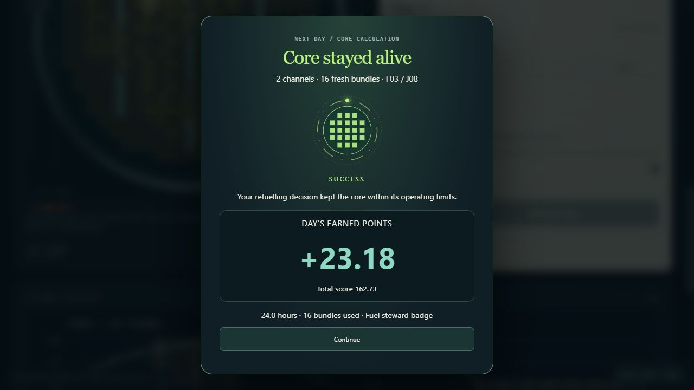
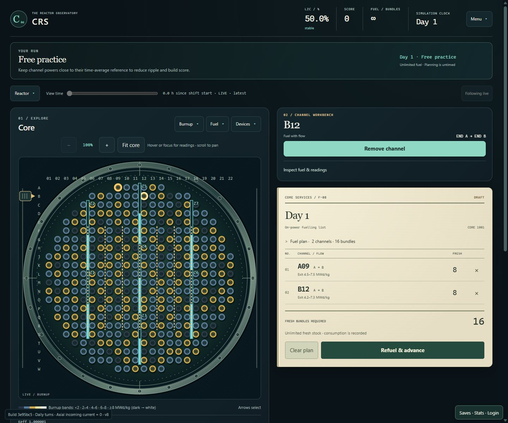
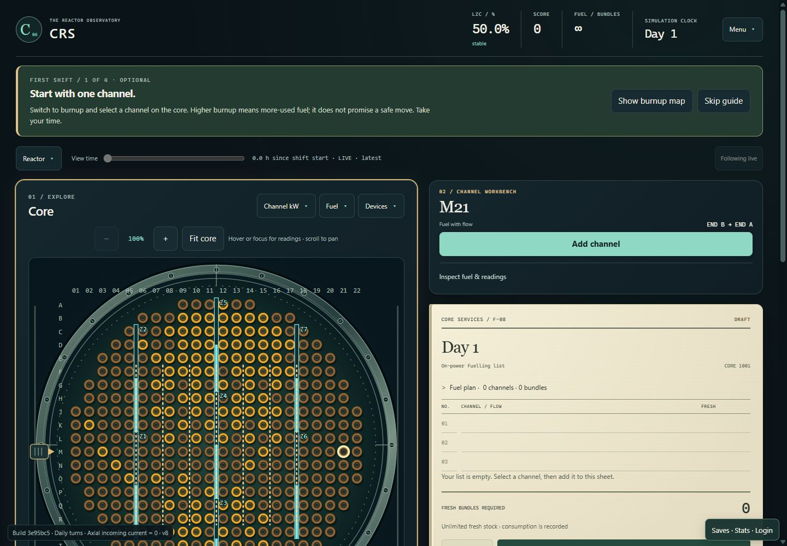
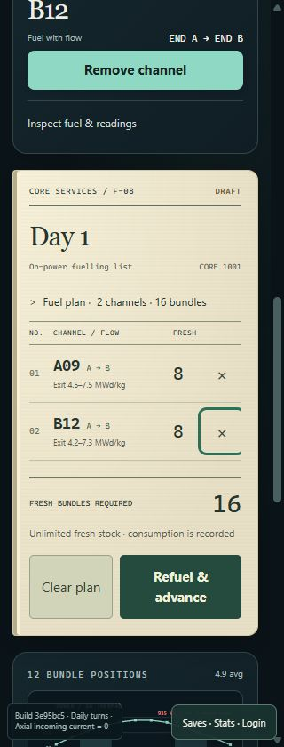

# Observatory — longer runs, first shift and the fuelling sheet

Implemented on `design/reactor-observatory`, 24 October 2026.

Implementation commit: `3e95bc5`. Run the Pages preview from
`web/candu-playtest` with `npm run preview -- --host 127.0.0.1 --port 4178`, then
open `http://127.0.0.1:4178/CRS/` after building the Pages package.

This extends the [visual redesign](REACTOR_OBSERVATORY_REDESIGN.md) with the
approved multi-day goals, optional first-minute guidance, a physical reactor
scene and a persistent fuelling-list form. The shared physics, integration,
operating limits and ripple-scoring policy are unchanged.

## Playable brief

The player repeatedly inspects channels, drafts eight-bundle orders and commits
a daily plan. The competing choices are where to refuel, how much finite fuel to
spend, and whether to advance without fuel. The visible consequence is a changed
core and the shared day's report. A multi-day run gives those decisions a bounded
session and a stock of fuel that must last beyond the current day.

The main pattern is spatial planning, supported by tangible order handling.
Selecting one channel fills one numbered row costing eight fresh bundles;
selecting two costs sixteen. Deselecting removes the row and changes the draft
total immediately, without consuming time or inventory. Existing no-fuel days
remain valid. The form does not require refuelling every day.

## New run goals

| Goal | Shared completion requirement | Fuel | Reward |
| --- | --- | --- | --- |
| Three-day rhythm | Complete three days within the existing operating limits | 128 fresh bundles for the entire run | Steady hands badge |
| Seven-day stewardship | Complete seven days within limits and discharge at least 48 bundles at ≥6 MWd/kg HM | 128 fresh bundles for the entire run | Fuel steward badge |

The launcher offers both goals as cards and in its existing objective selector.
Studio's Menu also starts a selected goal on the current seed. The visible run
banner shows completed days, the useful-bundle requirement where applicable, and
fuel remaining. Same-seed retry and new-core retry retain the objective.

`ShiftObjective` defines the authored identity, horizon, useful-fuel requirement
and reward. `ShiftProgress` evaluates completion and reward eligibility. The
existing clock, daily transaction, inventory and physical-loss handling remain
authoritative. Reaching 48 useful bundles early does not complete the week.
Numerical rejection remains distinct from physical loss. Modified sandboxes
remain ineligible for standard badges.

The browser protocol and save validators accept the two additional versioned
objective IDs. No old objective or save identity was renamed. Restore still
replays the shared command journal and checks its digest. Campaign scores are
excluded from the endless leaderboard through the existing eligibility checks.

## Optional first-minute introduction

**First shift · guided** starts unlimited free practice on seed 1001. The guide
stays in the workspace, can be skipped at any time, and follows actual actions:

1. **Select:** show the burnup map and choose a real channel.
2. **Read:** expand its fuel preview and distinguish OUT from KEEP.
3. **Draft:** add/remove channels on the sheet and choose when to commit.
4. **Reflect:** read the real day result and make a subsequent plan.

The relevant instrument receives a static highlight. The guide expands the fuel
detail while explaining it, then closes that detail to reveal the order sheet
when a plan is ready. It never selects a supposedly optimal channel, predicts
future power, sends a command, supplies fuel or advances the reactor. Guidance
can be reopened from Menu over the current run. A reset closes stale guidance.
Step announcements are short and polite; skipping restores focus to Menu.

## Persistent fuelling sheet

The form is styled as a ruled, lightly textured paper sheet with a draft stamp
and the current core seed. It contains:

- A stable numbered list sorted into shared execution order.
- Channel coordinate, flow direction and eight fresh bundles per row.
- Current outgoing burnup range, using the shared eight-position movement map.
- Individual removal buttons, fresh-bundle total and available stock.
- Clear/advance controls and the existing detailed day report in Studio.

Rows retain their DOM identity and keyboard focus when another row is added.
New rows settle into the form with a brief animation. Historical, submitted and
terminal sheets are visibly labeled and locked. An empty sheet shows blank ruled
lines rather than fabricated orders. A long list scrolls within its reading area.

Studio places its compact channel workbench above the side sheet. Detailed fuel
readings expand on demand; the wider axial plots sit below the main workspace.
Arcade uses the same order-list component beside its map, while preserving its
explicit review/run screens and persistent action button. On narrow screens the
core, workbench, form and supporting plots stack.

## Reactor materials and motion

All artwork is original code-native SVG/CSS, with no downloaded assets, fonts,
image service or new dependency:

- Concentric machined-metal vessel rings, twenty-four bolt heads and fine grain.
- Recessed circular channel sockets over the existing interactive map targets.
- A small rail-mounted locator following the selected channel.
- A brief confirmation ring at the last published fuel-movement channel.
- Paper fiber, ruled rows, stamped metadata and quiet order-insertion motion.

The locator represents selection. The ring follows a confirmed movement from the
shared result; it does not replay fictional intraday states. Initial loading or
reopening a view does not animate a past movement as a new operation. Animation
is bounded, canceled when the view closes, and suppressed for reduced motion.
Planning remains frozen. Existing channel value-band fills, labels, selection,
planned markings and power alerts retain their meanings.

## Verification

| Check | Evidence |
| --- | --- |
| Game suite | `tools/Test-DotNet.ps1 -Suite Game -Configuration Release`: 86 passed. Includes goal horizons, actual stock, early/late completion, useful-discharge threshold, modified-run eligibility and a real daily transaction. |
| Browser suite | `tools/Test-Browser.ps1 -Configuration Release`: 45 bridge tests and the frontend/database suite passed, followed by a production build. The final frontend run passed 199 tests after adding launcher reset/rejection coverage. |
| Focused frontend coverage | Ordered/stable/locked form rows, guide transitions and skip, both new save/journal IDs, and database acceptance with objective immutability and leaderboard exclusion. |
| Runtime packaging | Rebuilt authoritative AOT Release WASM and `/CRS/` frontend. Fixed Windows PowerShell's BOM in generated build metadata by writing UTF-8 without a BOM. |
| Daily acceptance | Real multi-channel and empty days, frozen planning, loss, recovery, narrow layout; no browser errors. |
| Arcade | Real selection, zoom, power/burnup, plan review, result and retry; 320/390/768/1280px; no page errors. |
| Accessibility | Keyboard-only menus/manual/map/plan/day/result/graphs, focus return, reduced motion, 200% zoom equivalent and 320px; no browser errors. |
| Maps/charts | Published value bands, exit tooltip, all twelve axial readings and off-scale limits retained; smoke passed. |
| Local/offline saves | Guest save, offline reload, WASM replay restore, same day/score/fuel/draft and 320px dialog; smoke passed. |
| Actual seven-day playthrough | Seed 2456367469, two observed high-burnup candidates per day: 7 days, 112 of 128 bundles used, 56 useful discharges, 162.73 points, Fuel steward badge. At day 6, 48/48 useful discharges still showed `in-progress`. |
| Committed branch isolation | Exported the staged branch independently of the pre-existing map work: 196 frontend/database tests and the production build passed. |
| New-goal restore | Saved Three-day rhythm after one day with an unexecuted channel on the sheet. Reloaded and continued through shared replay: same goal, one day complete, eight bundles consumed and the one-channel/eight-bundle draft retained. |
| First-minute guide | Actual map selection advanced steps 1→2; adding a channel advanced to step 3 without fuel consumption; a real completed day advanced to step 4. |
| Final package recheck | Build identity `3e95bc5`: daily smoke passed with no browser errors; guided launcher remained visible; the 320px sheet fit within its container, with 44×44px removal controls. Final accessibility acceptance also passed. |
| Reproduction | All six direct bridge cases matched across two samples; no browser errors. The deterministic matrix hash matches the pre-expansion result. |

The restored three-day run also completed and earned Steady hands.

The live fuelling sheet was also checked by deselecting a channel: the row count
dropped from two to one and the cost from sixteen to eight, without changing fuel
consumed. Re-adding restored the original order. Screenshots below are rendered
interfaces, not mockups. More captures and reproduction output are retained under
ignored `artifacts/observatory-expansion/`.

## Cloud deployment compatibility

The new migration
[`20261024181927_multi_day_goal_saves.sql`](../../supabase/migrations/20261024181927_multi_day_goal_saves.sql)
adds the two allowed objective IDs to the existing save function. Its ownership,
revision, immutable-run, pacing, length and payload checks remain intact, with no
new grants. Local Postgres-compatible tests exercised the migration and rejection
paths. It must be applied to the existing Supabase deployment before uploading
new-goal saves there. No live database migration or site publication was performed.

## Limits of the evaluation

This is an internally verified implementation. Goal difficulty, preference and
learning benefit still need human playtesting. Viewport/touch emulation does not
establish physical-phone performance, and Safari/Firefox were not tested. Live
authenticated cloud upload was not exercised. Native test restore reported an
unavailable NuGet vulnerability feed; the installed packages built and all tests
completed. Existing linker warnings were emitted during the AOT build.

Pre-existing map/zoom/scale work in the workspace was preserved. The original
simulation remains the sole reactor authority. This work does not add scram,
shutdown, accident behavior, plant controls or operator-training scenarios.
