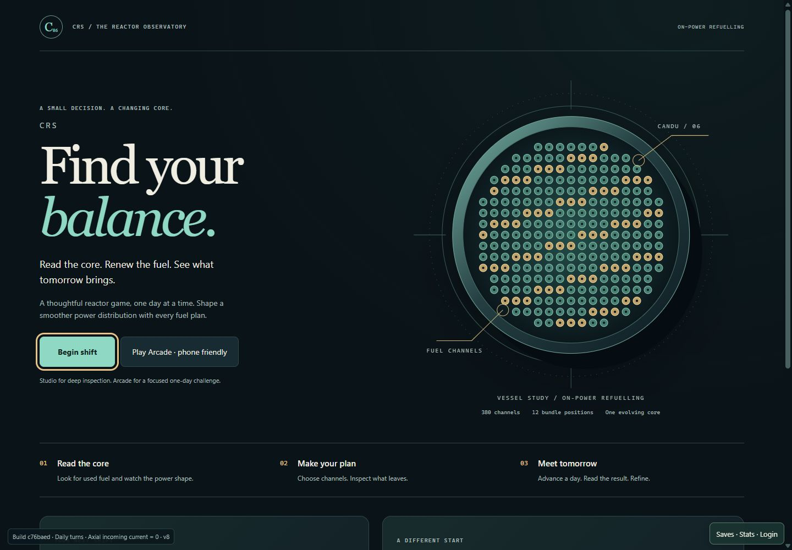
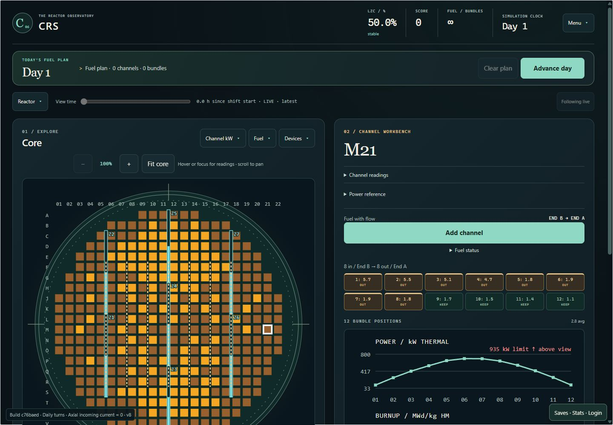
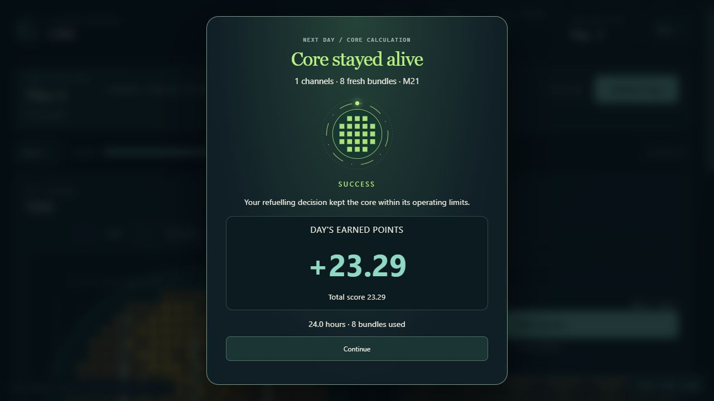
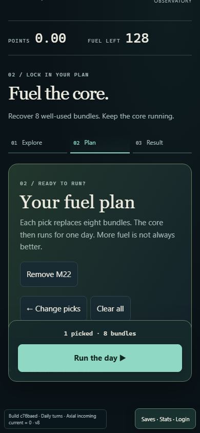
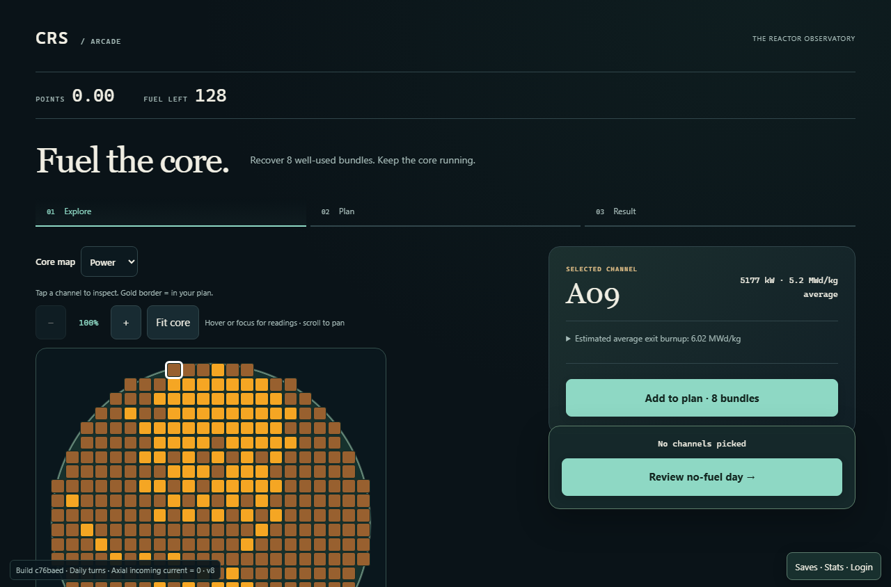
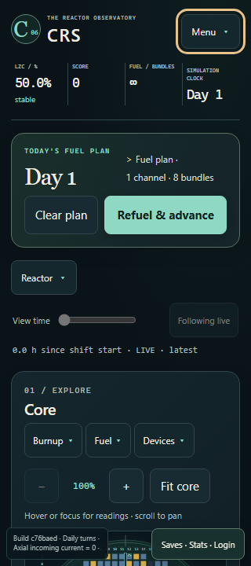

# CRS — The Reactor Observatory

Implementation and feature redesign report · 24 October 2026

Branch: `design/reactor-observatory`

Status: implemented presentation redesign, internally verified; awaiting human playtesting.

## Intent and boundaries

Reimagine the entire browser experience as a beautiful, deliberate game about
finding balance in an evolving core. The previous blue, heavily bordered control
panels become a coordinated set of instruments, a fuel workbench and a daily
decision tray. Studio and Arcade share one visual identity while retaining their
different levels of detail.

The playable loop remains **inspect → draft fuel moves → advance one day → read
the consequences → refine the next plan**. Nothing in this redesign changes the
reactor model, adds a command, modifies a score, grants fuel, introduces an upgrade,
or invents another objective. Shutdown, scram, accidents, plant operations and
operator training remain outside scope.

All Core, Game, Browser and BrowserHost sources are untouched by this work.
The browser continues to consume the authoritative shared WASM simulation.
The new Arcade stage indicator describes the existing screen state; it has no
control over simulation progression or rewards.

## Playable design brief

| Element | Preserved play, newly framed |
| --- | --- |
| Player role | Make on-power fuel decisions for an aged CANDU core. |
| Primary pattern | Deliberate spatial planning: compare channels, choose a plan, observe the next core. |
| Supporting pattern | A tactile workbench: identify outgoing and retained bundles before committing. |
| Repeated verbs | Inspect, add/remove, review, advance, compare, retry. |
| Visible consequence | Planned map outlines and bundle previews before commitment; day score, fuel use, changed readings and reports afterward. |
| Constraint | Existing power, tilt and mean LZC limits; finite challenge stock, unlimited practice stock. Planning remains untimed. |
| Competing choices | Replace more-used fuel, choose another location, or advance with no refuelling. More fuel is not presented as automatically better. |
| Progression | Existing elapsed days, cumulative score, fuel history and changing core distribution. No new unlock system. |
| Ending / return reason | Existing challenge outcome or a physical limit ends a run; practice continues. Same-seed retry supports improving a plan. |
| First minute | Choose Studio or Arcade, inspect a channel, read outgoing fuel, add it to the plan, then review or advance. |

For a concrete decision, one selected channel costs **eight fresh bundles** when
the day executes. Adding it to the draft costs nothing. Two channels use sixteen
bundles; a no-fuel day uses zero. In the verified seed-1001 Arcade example, one
selected channel discharged **four of the eight required useful bundles** and
earned **23.25 points**. The game correctly showed a missed goal, even though the
core survived. The redesign preserves that distinction rather than implying a
successful day automatically wins the challenge.

The skill's existing research informed the staged handling and visible
consequence pattern. This implementation does not claim new research into the
reference games, or measured improvements in enjoyment or retention.

## Art direction and interface system

| Decision | Implementation | Purpose |
| --- | --- | --- |
| Environment | Deep ink `#0a1318`, softly raised instrument surfaces, restrained directional gradients | Give the game a calm, coherent setting without competing with the power map. |
| Reading surface | Ivory `#f0eee3`, supporting text `#a7bcb9` | Separate important values from explanations and secondary detail. |
| Interaction | Teal `#8ed8c4` | Identify the principal action and current Arcade stage. |
| Fuel | Warm amber `#e7c38a` | Connect outgoing fuel, the workbench and plan-related emphasis. |
| Warnings | Existing red/bright-red map bands and textual reasons | Preserve the learned relationship between readings and limits. |
| Typography | System UI for controls, Georgia for expressive titles, system monospace for readings | Establish hierarchy while retaining readable numeric alignment and offline operation. |
| Material | Fine borders, subtle shadows, rounded instruments, flat chart interiors | Replace repeated bright bevels with depth and separation. |
| Motion | Short control transitions; existing event-based calculation and outcome motion | Acknowledge intent and results without animating a fictional reactor state. |
| Artwork | Original inline SVG vessel study and CSS surfaces | Supply a recognizable reactor identity without external asset or font dependencies. |

The title illustration is explicitly a **vessel study**, not a second live core
map. Its schematic dots do not represent the current reactor state. Only the
interactive maps display the actual 380 channels and their published readings.

The established discrete power, bundle-power, ripple and burnup map palettes
remain intact. The theme styles the vessel and surrounding interface, not the
meaning of a channel color. Existing amber adjuster and cyan LZC geometry also
retain their meaning.

## Feature-by-feature redesign

### Entry, modes and preparation

| Existing feature | Redesign | Function preserved |
| --- | --- | --- |
| Game identity | Observatory masthead, circular C06 emblem and editorial “Find your balance” cover | CRS remains the document title and game heading. |
| Launcher | Two-column cover with original vessel art; stacked composition on phones | Waits for the same authoritative core and fails closed without it. |
| Begin shift | Prominent teal primary button beside the game introduction | Opens Studio over the current session. |
| Arcade entry | A secondary action beside Studio with an explicit mode explanation | Uses the existing one-day challenge reset and only opens after acceptance. |
| Introduction | Three concise numbered cards: read the core, make your plan, meet tomorrow | Teaches existing actions; no tutorial engine or progression gates. |
| Current objective | A dedicated “Your next shift” card and live readiness text | Displays the same shift, seed and fuel information. |
| Readiness / loading | Quiet status text with an available primary action once ready | Existing pending and unavailable states still determine availability. |
| Seed entry | A compact configuration card; side-by-side fields when space allows | Same seed validation and deterministic reset command. |
| Practice / challenge selection | Existing objective selector grouped with the seed | Same unlimited-practice and finite-challenge contracts. |
| New aged core | Secondary button inside the starting-core card | Same browser-generated random seed behavior. |
| Manual entry | A full-width reference action in the shift card | Opens the existing bundled manual and returns focus. |

### Studio and the daily decision

| Existing feature | Redesign | Function preserved |
| --- | --- | --- |
| Studio frame | Ink workspace with a restrained masthead, instruments and paired core/workbench cards | One Studio view and one session; no second state owner. |
| Mean LZC | Numeric header instrument with a quieter status caption | Same shared mean fill and published operating state. |
| Score | High-contrast monospace reading in the instrument header | Same ripple-based accumulation; no direct move bonus. |
| Fresh fuel | A separate inventory reading using finite stock or infinity | Same published stock and practice unlimited-fuel flag. |
| Simulation day | A distinct day reading and large serif day label in the plan tray | Same completed-day count; planning remains frozen. |
| Daily fuel plan | A softly highlighted decision tray above the core | Same ordered draft, eight bundles per channel and review contents. |
| Add / remove channel | Teal workbench action positioned above supporting plots | Same existing draft toggle; no fuel or time consumed. |
| Review plan | Expandable fuel list with rounded order cards and individual removal actions | Same outgoing burnup, sorted execution order and editable draft. |
| Clear plan | Secondary action beside the day commitment | Same draft-only clear operation. |
| Advance with fuel | Distinct primary action at the end of the daily tray | Same `commit-day`, expected day and channel indices. |
| Advance without fuel | The same primary position with existing no-fuel wording | Still a valid empty plan; no invented penalty or requirement. |
| Pending day | Existing calculation presentation restyled as a focused outcome card | Work remains genuinely pending; no fake completion percentage. |
| Day success | Large earned-point reading, total score and consumption receipt | Existing accepted result and score delta. |
| Physical loss | Same outcome surface with the published ending reason | Limit violations remain physical outcomes, distinct from rejected orders. |
| Rejection / failure | Existing message paths retain their text and phase | Invalid plans and numerical failures do not become successes. |
| Day report | Expandable ledger below the tray, using the shared spacing and border system | Retains energy, fuel, score, unexecuted orders and bundle identities. |
| Shift objective details | Restyled mission detail in the existing Menu | Objective and reward rules are unchanged. |
| Shift report | Larger result typography and a three-part energy/fuel/score ledger | Same ending reason, provenance, totals and reward state. |
| Same-seed retry / new shift | Consistent primary and secondary replay actions | Same retry objective, seed preservation and new-core behavior. |

### Spatial core and channel workbench

| Existing feature | Redesign | Function preserved |
| --- | --- | --- |
| Full core map | A vessel-like instrument well, fine orientation rings and a numbered “Explore” heading | Actual channel positions, indices and snapshot readings are retained. |
| Channel / bundle power maps | Existing warm bands framed by a quieter teal vessel | Same units, thresholds, limits and alert behavior. |
| Burnup / ripple maps | A common dropdown and consistent legible legend treatment | Same mode calculation and discrete bands. |
| Selected vs planned channels | Existing white selection and gold planned markings retained | Inspection remains separate from adding a fuel order. |
| Hover / keyboard tooltip | Dark raised reading card with a warm channel heading | Same current power, peak bundle, ripple and exit-burnup estimate. |
| Zoom and pan | A coordinated instrument toolbar and compact numeric zoom readout | Existing 100–400% zoom and scrolling/panning retained. |
| Fuel watchlist | Raised dropdown with clear selected candidate emphasis | Same eligible-channel ranking and Highest burnup action. |
| Adjuster / LZC overlays | Restyled device panel and selected controls | Same shared device geometry, face planes and meanings. |
| Channel identity | Large serif coordinate in the “Channel workbench” card | Same selected-channel coordinate and directional data. |
| Channel readings | Fine-divider disclosure with aligned numeric readings | Same power, ripple, bundle peak and tilt values. |
| Power reference | Supporting reference disclosure in the same reading hierarchy | Same fixed reference, comparison and published units. |
| Fuel direction | A small direction label immediately before the action | Same channel-flow direction and incoming/outgoing ends. |
| Bundle movement preview | Twelve material-like slots; amber outgoing fuel and teal retained fuel | Same shared movement plan and published burnup per position. |
| Non-color fuel distinction | Visible “OUT” and “KEEP” labels on the preview slots | Styling follows existing outgoing/retained attributes; no movement is recomputed. |
| Axial power / burnup | Quiet plot well, teal power trace and amber burnup trace | Same twelve-position physical order, values, bounds and labeled off-scale limits. |
| Iodine / xenon detail | Restyled existing disclosure and plots | Same bundle inventories, history and zero-inventory fresh fuel. |
| Last fuel movement | A consistent response card below the workbench | Same confirmed movements, bundle identities and result feedback. |
| Fourteen zone levels | Taller liquid columns with visible fill edges and numeric captions | Same fourteen fills, limiting-zone indication and controller report. |
| Footer guidance | Quiet reference text and preserved shortcut reminder | Existing limits and F1/N/R controls remain available. |

### History, Arcade and supporting surfaces

| Existing feature | Redesign | Function preserved |
| --- | --- | --- |
| History view selection | A unified instrument dropdown with stronger active-state styling | All Reactor, power, discharge, zone, tilt, reactivity, poison, fuel and score views remain. |
| History charts | Full-width reading cards, muted grid lines and consistent legends | Same retained observations, axes, units, outlier expansion and trace toggles. |
| Time inspection | A quiet time rail and clear Return to live control | Historical inspection still disables operations and preserves the draft. |
| Time window | Same selector in the redesigned chart heading | Same all / six-hour / day / week windows. |
| Arcade identity | The same ink/ivory/teal materials with a stronger challenge title | Still the existing one-day game over the shared session. |
| Arcade flow | Explore / Plan / Result rail, including an accessible current-step marker | Describes existing pick, review and terminal screens; adds no game state. |
| Arcade map | Consistent vessel well, toolbar and legend | Actual 380-channel power/burnup map and touch zoom retained. |
| Arcade inspector | A compact channel card with clear eight-bundle action and outgoing-fuel disclosure | Same eligibility, fuel budget and selection checks. |
| Arcade review | A warm plan card with removable picks and a distinct run action | Same explicit review, empty-plan review and shared day commitment. |
| Arcade action footer | Sticky decision card; aligned to the inspector side on desktop | Same persistent review/run buttons. Final refinement avoids obscuring the desktop core. |
| Arcade result | Large outcome typography and a medal for the existing reward | Uses the published outcome; missed objective is not displayed as a win. |
| Arcade replay | Clear primary retry and secondary new-core buttons | Same seed/objective reset behavior. |
| Open Studio | Existing detail action styled to match the workbench | Keeps the same run and draft. |
| Manual | A reading-focused dark library, warm links and coordinated navigation | Same bundled chapters, keyboard focus trap, Escape and restored focus. |
| Saves / stats / login | Matching floating entry, modal surfaces, buttons and dividers | Local, guest, cloud and leaderboard paths unchanged. No schema or account changes. |
| Build / update status | A quiet, readable build plaque and matching update dialog | Same loaded-build identity and safe local-save/update workflow. |
| Bridge recovery | A matching recovery surface with a distinct available action | Same fail-closed behavior and recovery command. |
| Narrow layout | Stacked cards, wrapped menus and touch-sized principal buttons | Existing 320px support and zoom affordances retained. |
| Focus / reduced motion | Warm visible focus rings; static equivalents for animated information | Existing keyboard operation, focus restoration and reduced-motion behavior retained. |

## Implementation and review boundaries

The new `src/observatory.css` is imported after the existing presentation styles.
It provides one coordinated visual layer across launcher, Studio, Arcade, manual,
accounts, update and recovery surfaces. This keeps the redesign reviewable without
rewriting the existing rendering and event-handling systems.

Markup changes are limited to the launcher composition and SVG artwork, Studio
branding/section labels and workbench order, and Arcade's existing-stage indicator.
The workbench action moves before the axial graphs in the actual DOM, so visual
and keyboard order agree.

The accessibility smoke updates its title selector for the new launcher structure
and its geometry assertions for the new spacing. It still requires a large core
and channel graph, and now also checks that the channel action is visible within
the first 720 desktop pixels. The accepted 1280px capture measures a **610.25px
core** and a **500.56px channel graph**. Keyboard, focus, frozen planning and real
day execution checks remain in the smoke.

There were already uncommitted map, scale, zoom, tooltip, documentation and skill
changes when this task started. They were carried onto the new branch without
reverting them. In particular, zoom/tooltip/discrete-map work is preserved prior
work, not a new mechanic introduced by this redesign. Local before-edit copies
and a patch remain under ignored `artifacts/observatory/` for review separation.

## Verification evidence

Test environment: Windows, local production preview at `/CRS/`, Chromium via the
repository's Playwright smoke tools, plus direct visual interaction in the in-app
browser. Runtime metadata reports the staged AOT Release WASM from
`c76baedca0567a39059373ceaee9dca66f4a5893`. The frontend includes the branch's working
changes; the displayed runtime SHA identifies the staged shared runtime, not a
claim that the redesign has been deployed.

| Check | Result |
| --- | --- |
| `tools/Test-Browser.ps1 -Configuration Release` | Passed: 43 browser .NET tests, 190 frontend tests, production frontend build. |
| `npm run build:pages` | Passed for the `/CRS/` subpath. |
| Daily acceptance smoke | Passed: frozen planning, multi-channel day, empty day, narrow layout, physical loss and unavailable-WASM recovery; no browser errors. |
| Arcade smoke | Passed: map selection, touch zoom, power/burnup, 320/390/768/1280px layouts, real WASM day, result and retry. |
| Accessibility smoke | Passed: keyboard-only entry/seed/objective/map/plan/day/result/graphs, 320/640/1280px, 200% zoom equivalent, reduced motion, manual focus trap, focus restoration and quiet announcements; no browser errors. |
| Display-scales smoke | Passed: zoom tooltip, actual exit preview, all twelve axial readings, unchanged map bands, chart ranges and labeled limits; no browser errors. |
| Saves smoke | Passed: guest, local save, offline reload, WASM replay restore, same score/day/fuel/draft, paused restore and 320px dialog. |
| Direct WASM reproduction | Passed: six representative direction/channel cases matched across two samples; all twelve command rows accepted; no console or page errors. This exercises the existing direct bridge comparison path, not a new gameplay mode. |
| Direct visual day | Added one channel without consuming fuel; advanced to Day 2; success showed +23.29 points, eight bundles used and 24 hours. |
| Final diff whitespace | `git diff --check` passed. |

NuGet vulnerability metadata was unavailable during restore; the existing cached
packages built and all 43 bridge tests completed successfully. No dependency or
lockfile was changed by the redesign.

### Visual evidence

The images are real rendered interfaces, not design mockups. Additional internal
captures and machine-readable smoke results are retained in ignored
`artifacts/observatory/`.













## Controls and running the branch

Start with **Begin shift** for Studio or **Play Arcade** for the one-day challenge.
Select a channel, inspect its fuel, and add/remove it from the plan. In Studio,
review the daily tray and choose the existing advance action. In Arcade, review
the picks before running the day. `N` selects Highest burnup; `R` toggles the fuel
plan; arrows navigate the Studio map; `F1` opens the manual. Zoom and scrolling
make smaller channel targets usable on narrow screens.

From `web/candu-playtest`, use `npm run dev`. For the release-shaped preview:

```powershell
npm run build:pages
npm run preview -- --configLoader runner --outDir dist-pages --base /CRS/ --host 127.0.0.1 --port 4176
```

This work creates a local branch and preview. It does not publish or alter the live
GitHub Pages deployment.

## Material limitations and next evaluation

- This is an internally verified redesign, not an externally playtested release.
  Human play is still needed to validate comprehension, preference and enjoyment.
- Phones were checked with browser viewport/touch emulation, not physical iOS or
  Android devices. Safari, Firefox and actual phone performance were not tested.
- Account and cloud paths were visually restyled; live authenticated GitHub/cloud
  write flows were not exercised. The guest/local/offline route was exercised.
- Existing live build-update behavior was preserved. A new two-version update
  rollout was not performed for this presentation change.
- The main map may require vertical scrolling, especially on short or narrow
  displays. On phones, use the existing zoom controls for larger channel targets.
- No audio, illustration download, font service, analytics, new dependency or new
  game mechanic was added.

A useful first human test is to hand a new player the game without a walkthrough
and observe whether they can select a channel, explain which fuel will leave,
commit one day, and distinguish survival from earning the challenge reward.
Those are proposed observation questions, not claimed study results.
