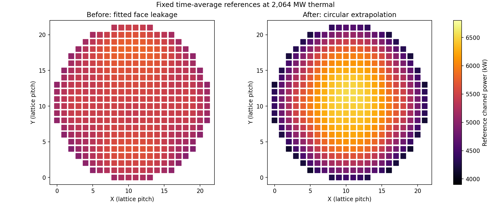

# Circular radial extrapolation, v9

The active pack is `candu6-two-group-diffusion-v1-radial-circle-v9`.
The shared Core loss operator now extrapolates each exposed X/Y face to zero
flux on one concentric circle. Previously every exposed radial face used the
same small fitted leakage conductance, giving an almost flat radial reference.

The authored geometry is a 0.28575 m pitch, 3.35 m physical envelope enclosing
the staircase cell corners, and a 2.2 m effective reflector extrapolation
distance. The zero-flux circle therefore has radius 5.55 m. This large distance
represents the game's effective reflector; it is a calibration parameter, not
a material vacuum extrapolation length or a measured plant reflector thickness.

```json
"radial_boundary": {
  "condition_id": "circular-extrapolated-zero-flux-v1",
  "pitch_m": 0.28575,
  "core_radius_m": 3.35,
  "extrapolation_distance_m": 2.2
}
```

The canonical 22 by 22 lattice is centred at (10.5, 10.5). For physical
node-centre coordinates `(x,y)` and extrapolated radius `Re`, the east-face
distance is `sqrt(Re²-y²)-x`; west changes the last sign. North/south use
`sqrt(Re²-x²) ∓ y`. Each group's face conductance is
`C_face,g = C_xy,g * pitch / distance`, equivalently `D_g A / distance`.
The distance already includes travel from the cell centre, so no extra half-cell
is added. Distances depend on position and face direction; the circle is shared
by both groups. This is a Cartesian finite-volume boundary approximation, not
an analytic cylindrical-core solution or a new reflector mesh.

The [v8 axial Marshak condition](axial-marshak-v8.md), its two end conductances,
interior axial/transverse coupling, node volume, fuel heating, burnup knots,
absorption/downscatter curve and xenon reference are unchanged. Reflective face
overrides still have exactly zero leakage. Packs without a radial declaration
retain legacy radial conductance. Unsupported, missing, nonfinite or
nonpositive radial geometry fails closed, as does a physical envelope too small
to contain the lattice cells. Pack and coefficient digests include the change.

## Calibration and references

The [reproducible fit](../../data/calibration/radial-circle-v9/fit/fit.json)
uses archived v8 inputs and seed 1001 at half-filled zones, iterating equilibrium
xenon while restoring criticality and frozen-Xe device worths. A common
nu-fission multiplier of 1.0202448758946345 restores criticality without changing
Sigma-f, heating or the relative fuel-production curve. Adjuster and water
absorption strengths restore 17 and 7 mk respectively. Tight independent checks
give Keff 1.000000247, adjuster worth 17.000603 mk and zone worth 7.001736 mk.
Fuel-only frozen-Xe loss is 0.456183 mk/FPD versus the v8 0.439384 mk/FPD (+3.8%).

The time-average channel/node reference is regenerated by the same solver,
including its equilibrium xenon and half-fill zones. Its identity is now
`cycle190-time-average-21-adjusters-radial-circle-half-zones-v6`.
RRS regional targets and scoring consume these new references automatically.
Old saves are incompatible with the new physics identity and remain stored.

| Fixed reference | Before, v8 | Circular, v9 |
| --- | ---: | ---: |
| Lowest channel, kW | 4,931.5 | 4,123.0 |
| Outermost 20 channels mean, kW | 5,094.1 | 4,215.7 |
| Middle mean, kW | 5,510.5 | 6,395.1 |
| Highest channel, kW | 5,787.5 | 6,526.0 |
| Total thermal power, MW | 2,064 | 2,064 |

The revised requested rim target is approximately 4,000 kW. Middle means use
channel centres within four pitches of the centre; the outermost 20 lie beyond
10.7 pitches. These are fixed time-average targets, not clamps on instantaneous
seeded/fuelled power. No channel or bundle power is clipped.



## 100-day acceptance

The [before/after campaign archive](../../benchmarks/radial-circle-v9-2026-10-30/README.md)
records fresh baseline and final 100-day runs with the same seed and player
policy through the native versioned Browser bridge. Both complete 100 days;
fuel use changes by 0.44%, discharge burnup by 0.10%, score by 0.07%, and total
energy is unchanged. The final campaign's peak channel/bundle powers are
6,859.5/853.7 kW, below the unchanged 7,100/900 kW limits. This is a shared-physics
campaign, not a 100-day WASM latency test or evidence for every seed/policy.

An earlier 1.9 m trial reached day 81 before crossing 7,100 kW. The final 2.2 m
distance was chosen after that failure; the limits and the policy were retained.

Reproduce using a new output prefix:

```powershell
dotnet run --project tools/AgedCoreBenchmark -c Release -- --fit-radial-circle data/calibration/radial-circle-v9/source-pack.json tmp/radial-fit 2.2
dotnet run --project tools/LongRunPlaytest -c Release -- --pacing=daily-turn --policy=oldest-lzc --channels-per-day=2 --days=100 --seed=1001 --output=tmp/radial-100-days
dotnet run --project tools/ChannelReferenceBenchmark -c Release -- tmp/radial-reference
python tools/AgedCoreBenchmark/report-radial-circle.py benchmarks/radial-circle-v9-2026-10-30
```

`--probe-radial-circle` accepts the same arguments as the fit and writes a
pre-refit reference for sensitivity checks. It never stages a pack. The active
pack remains a project-authored surrogate for gameplay.
