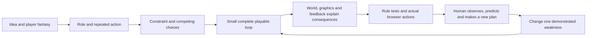

# Browser Game Studio: research and reusable framework

Research completed 24 October 2026. This library studies ten established itch.io
browser simulations and two adjacent games, then turns their design relationships
into a reusable skill and ten small, original playable studies. It is a first
validated iteration; human playtests have not established that its outputs are fun.

## Read or play

- [Twelve detailed case studies](../../skills/browser-game-studio/references/case-studies.md):
  creator sources, inspected actions, design interpretation, art/motion recipes
  and a question for the next playtest.
- [Design framework](../../skills/browser-game-studio/references/design-framework.md):
  turn a setting into a role, verb, consequence, constraint and changing decisions.
- [Graphics and animation](../../skills/browser-game-studio/references/motion-and-art.md):
  coherent art direction, event-driven feedback and reduced-motion alternatives.
- [Off-the-shelf comparison](../../skills/browser-game-studio/references/toolkit-selection.md):
  game engines, templates, agent skill packs and complete production pipelines.
- [Skill entry point](../../skills/browser-game-studio/SKILL.md) and
  [run/scaffold instructions](../../skills/browser-game-studio/references/running-the-lab.md).
- [Validation record](../../skills/browser-game-studio/references/validation-record.md)
  explains which outcomes were tested and what remains untested.

The local preview is [Pattern Lab](http://127.0.0.1:8010/assets/pattern-lab/).
Its server must be running. The portable source lives in
`skills/browser-game-studio/assets/pattern-lab/`; it has no npm runtime dependencies.

## Ten primary studies

| Reference | Main transferable relationship | Original playable study |
| --- | --- | --- |
| [Sort the Court!](https://graebor.itch.io/sort-the-court) | A character turns a resource tradeoff into a request with consequences | Cloud Council: eight competing town requests |
| [Peggy's Post](https://digitarium.itch.io/peggys-post) | Objects, tools and destinations make work tactile | Moonpost Desk: exact postage and parcel routing |
| [Waterworks!](https://scriptwelder.itch.io/waterworks) | Prerequisites and connections make infrastructure legible | Water District: connected pipes and scarce pump capacity |
| [1,000,000 shrimp](https://jontopielski.itch.io/1000000-shrimp) | Experienced manual work gives automation a purpose | Night Harvest: hand gathering, nets and vessel upgrades |
| [Peckin' Pixels](https://wavingwalrus.itch.io/peckin-pixels) | Individual creatures make needs and collection emotionally legible | Meadow Flock: feeding, hens, nest capacity and egg sales |
| [The MachinEGG](https://quantumgames-studio.itch.io/the-machinegg) | A visible chain shows which bottleneck an upgrade removes | Copper Works: ore, presses, bounded output and shipping |
| [plant daddy](https://overfull.itch.io/plantdaddy) | Attractive intermediate growth gives a calm reason to return | Window Garden: water, growth, cuttings and additional pots |
| [Evolution](https://keiwan.itch.io/evolution) | Comparison makes repeated experiments purposeful | Creature Trials: seeded parameter trials and elite selection |
| [Orb of Creation](https://marple.itch.io/orb-of-creation) | Production, conversion and capacity create different limits | Lumen Workshop: charge, light, material and storage |
| [Gourdlets](https://aunty-games.itch.io/gourdlets) | Composition, observation and revision can replace scoring | Pocket Hamlet: original isometric building and undo |

Planet Life and Tiny Islands add progression/story and spatial/card comparisons.
They are source-only adjacent studies, not additional completed gameplay sessions.
The sample is deliberately varied; it does not establish a universal ranking of
the best games. Full endings were not played through. Each case records its limits.

## How the framework connects

The diagram separates implementation verification from design evaluation.
Automated tests can establish that a rejected shipment spends nothing; a new
player must still show whether reading and routing parcels is enjoyable. A
coherent visual style makes the world understandable, while progression must
change the player's available decisions rather than merely inflate numbers.

For a new 2D sprite game, this research recommends starting from the
[official Phaser TypeScript/Vite template](https://github.com/phaserjs/template-vite-ts),
after checking its actual installed major version. The
[LeanEntropy skill pack](https://github.com/LeanEntropy/threejs-phaser-game-skills)
is a useful portable reference with MIT licensing; its Phaser guidance targets
version 3. [Tencent GCA](https://github.com/Tencent/Game-Creation-Agents) is the
closest complete production pipeline found, but brings a larger runtime and
external media-service setup. These are source-inspection recommendations,
not independently reproduced toolkit benchmarks.

The original lab stays separate from CRS. It changes no authoritative reactor
rules or current browser product files. Future CRS improvements should apply the
design/feedback lessons through the existing shared simulation and browser bridge.
